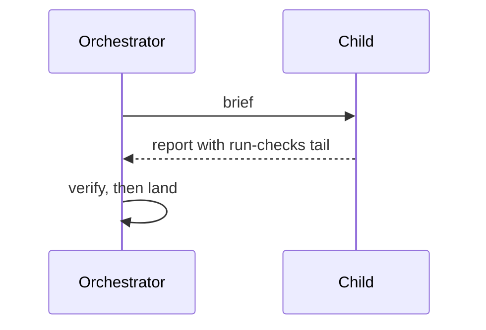

# Summary visuals

The shapes `pr-describe` picks from for a pull request's Summary. Pick the **smallest** one that
makes the change's point clear to a reviewer who has not read the diff. Each shape below says what
kind of change it fits and what to leave out.

The house style allows a code-shaped sketch in a pull request summary and keeps flows and graphs in
Mermaid (`house-style.md`, "Formatting"). In a target repository with its own rule on diagrams, that
rule wins.

## Choose by what the change is

| The change is mostly | Shape | Keep in it |
|---|---|---|
| Several parallel edits of one kind (five skills each gain a line, three flags renamed) | A table, one row per item | The item and what changed for it; nothing the diff already lists per file |
| A behaviour that differs before and after | A before and after: two short code blocks, or a two-column table | The input and the two outputs, not the code that produces them |
| Files moved, split or created | A shallow file tree | Only the directories the change touches, two or three levels at most, a few words of role per entry |
| Messages or control passing between parts (a request path, a hook, a handoff) | A Mermaid `sequenceDiagram` or `flowchart` | The parts that the change adds or reorders, and the one or two neighbours that give them context |
| Logic or an algorithm | Pseudocode | The decision points and the result, in the project's words, with no syntax a reader must parse |
| A change to who calls whom | A call tree, indented | The changed call and its parent and children, nothing deeper |
| An addition or removal inside a shape the reader already knows | A diff-shaped sketch (a `diff` block over the tree, the call tree or the pseudocode) | `+` and `-` only on the lines the change adds or removes; the unchanged lines are the frame |

## Rules for every shape

- **A sketch, never the diff.** A handful of lines that show the shape. A pasted hunk restates the
  diff and hides the point; the reviewer reads the real diff anyway.
- **Beside its sentence.** Each visual sits under the one or two sentences it supports, and those
  sentences say what to look at in it.
- **The project's words.** Labels use the glossary's terms, the same as the body around them.
- **One is usual, two is the most.** A Summary that needs three visuals is describing several
  changes, and is a hint that the branch could be a stack (the stack offer in Step 2).
- **No visual for a trivial change.** A typo, a version bump or a one-line fix is clearer as one
  sentence.

## Examples

A diff-shaped sketch of a file-layout change:

```diff
 .agents/skills/pr-describe/
   SKILL.md
+  references/
+    visuals.md      # the Summary shapes
```

A call tree for a change that adds one step:

```text
review
  pick depth
  run spec axis
+   quote each guard of the contract
  run standards axis
```

A Mermaid sequence for a new handoff:



A before and after for a behaviour change:

| | Before | After |
|---|---|---|
| `retro` on an idea the register declined | proposes it again | dismisses it, quoting the register line, unless new evidence is named |
