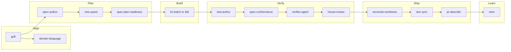
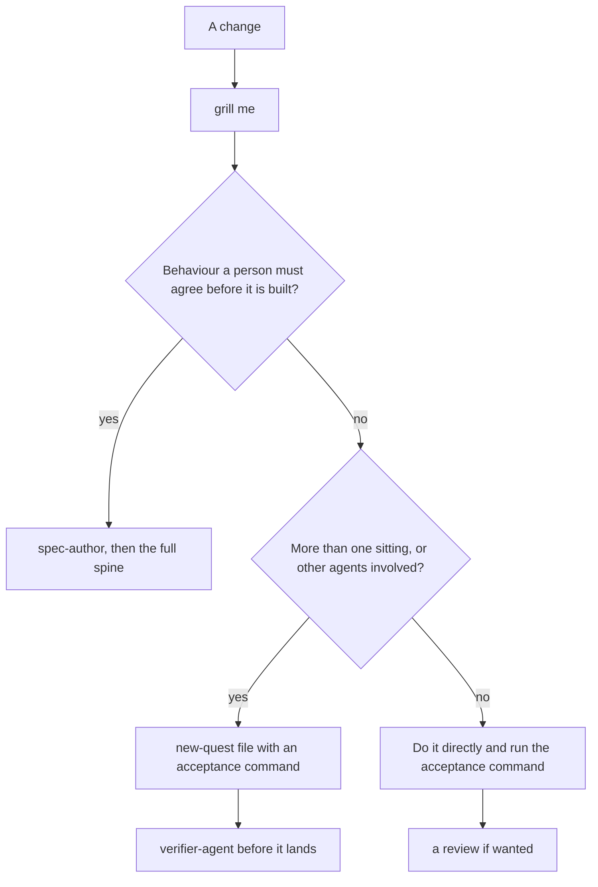

# Zen Agent Skills

[](LICENSE)

A portable library of agent skills that moves the rigor of AI-assisted work to the two places it compounds: a written agreement before the work, and independent verification with evidence after it. One harness-agnostic `SKILL.md` per skill, installed into Claude Code, OpenCode, Cursor, and VS Code or Copilot from a single source.

## Quick start

**Claude Code, as a plugin** (recommended; no clone, no Python):

```bash
claude plugin marketplace add zen-solutions-dev/zen-agent-skills
claude plugin install zen-agent-skills@zen-agent-skills
```

Update with `claude plugin marketplace update zen-agent-skills` then `claude plugin update zen-agent-skills@zen-agent-skills`. Plugin skills are namespaced (`/zen-agent-skills:new-quest`), and the plugin carries no drafts.

**Any harness, with the installer** (Python 3.11 or newer and Git), for OpenCode, for drafts, or to own your copy of the lenses:

```bash
git clone https://github.com/zen-solutions-dev/zen-agent-skills.git
cd zen-agent-skills
python scripts/install.py --dry-run   # preview: changes nothing
python scripts/install.py             # the default skill set, for Claude Code and OpenCode
```

The installer is idempotent, reports a conflict instead of overwriting a file it does not manage, and is reversed with `--uninstall`.

Drafts come only through the installer; `install.py --dry-run` prints the current list of drafts. To try them:

```bash
python scripts/install.py --tools claude --include-drafts
python scripts/install.py --skills teach --include-drafts   # one skill and what it composes
```

**Use one route per harness.** The plugin and the installer's `claude` target place the same skills under different names, so having both loads every description twice. To try the drafts in Claude Code, use the installer for Claude Code instead of the plugin.

Then, in each repository, run `init-worktracking` once: it sets up quest tracking (`.quests/`) and **configures the skills for that repository** in `docs/agents/zen.md` (tracker, glossary, specs, acceptance command, branches, whether work defaults to running unattended), asking you one section at a time. For a new repository, start with `project-bootstrap`, which hands over to it. After that, start with **"grill me"** on the change you want to make, or ask `zen` which skill fits. Both come with the plugin; with the installer, `grill` is in the default profile and `zen` in `--profile all`.

Cursor, VS Code or Copilot, and Codex use project-level adapters instead, and narrower profiles keep the description budget small. Both are in [`docs/INSTALL.md`](docs/INSTALL.md), with uninstall and troubleshooting.

## What's new in this release

Nothing is tagged since `v0.1.0`; the next release is cut on the maintainer's go, as [`docs/RELEASING.md`](docs/RELEASING.md) describes. What it will carry, newest first.

The 2026-11-27 promotions, planned in [the promotions plan](docs/reviews/2026-11-27-promotions-plan.md): `sitrep`, `vet-skill`, `research` and `orchestrate` are promoted from drafts, each refined from its real use first. They come with the plugin, and with the installer in `--profile all`. `agent-observatory` and `quest-tracker` stay drafts, extended until their core actions run on real work.

The 2026-11-25 Marjana round 2, planned in [the round 2 plan](docs/reviews/2026-11-25-marjana-r2-plan.md):

- **Tasks are now quests.** `.tasks/` is `.quests/`, `new-task` is `new-quest`, and the hierarchy is Campaign, Quest chain, Quest and Side quest ([`GLOSSARY.md`](GLOSSARY.md)). An adopter's `.tasks/`, `tracker: tasks` and `new-task` keep working, with a warning: v0.2.0 warns; v0.3.0 removes the old names.
- **Six new drafts**: `teach`, `vet-skill`, `prototype`, `wayfinder`, `wait-what`, and `triage`, which sorts GitHub issues into role labels. Opt-in tracker publishing, in the `triage` draft and loaded by `new-quest` when installed, mirrors the local tracker one way to GitHub issues; it and `triage` stay drafts until a live run.
- **Sharper review and landing.** `house-review` checks every guard of a contract and adds a security axis on a one-way door; an orchestrator may land by a mechanical merge, and a repository may opt into a sampled self-merge of a two-way door (`A8`).
- **New gates**: a changelog line-length warning, a check that `zen` and the catalog name every skill, a composed-by check, a quoted-phrase audit, an opt-in destructive-git hook, and a `VERSION` file with [`release.py`](scripts/release.py).

The 2026-11-24 "Marjana" round, a deep clean planned in [the Marjana plan](docs/reviews/2026-11-24-marjana-plan.md) from [what Matt Pocock's newest work teaches](docs/reviews/2026-11-24-sources-delta.md) and [an inventory of this repository's own dust](docs/reviews/2026-11-24-marjana-inventory.md):

- **Configure once per repository.** `init-worktracking` now ends by configuring the skills: one committed file, `docs/agents/zen.md`, says where this repository keeps its tracker, glossary, specs and acceptance command, so no skill has to rediscover it. The format is a [draft contract](docs/spec/zen-config.md) checked by the scaffolded `validate.py`.
- **Orchestrate a day of work.** `orchestrate` runs one session that holds the conversation with you while child agents research and build on their own branches, lands each verified commit on one integration branch, and hands you one pull request. `research` writes one cited report per question. The autonomy rules now say exactly which merge an orchestrator may make (`A8`).
- **AFK or human in the loop, named.** A quest can say `mode: afk` or `mode: hitl`, set from how reversible the change is and how far it reaches.
- **Review once, fix once, then stop.** `house-review` re-checks only the fixed findings after one fix round. `retro` samples sessions, ratchets a stricter check in with an exception list, and prunes checks that fire on good code.
- **Lighter to carry.** This repository's always-loaded `AGENTS.md` fell from about 28 KB to about 9 KB, the two scaffolds no longer spend an adopter's description budget, and the installer's budget figure now counts only what Claude Code loads.
- **New gates for the drift this round found**: a warning for a workflow step with no completion criterion, and a roadmap check that fails when a skill's stated status disagrees with its frontmatter.

Each skill this round touched was run on the round's own work or a scratch adopter repository, or is recorded as not exercised with the reason (`systematic-debugging` met no defect that needed it), in [the dogfood records](docs/reviews/2026-11-24-dogfood/README.md).

The 2026-11 overhaul before it, compared against Matt Pocock's skills and written up in [the overhaul plan](docs/reviews/2026-11-overhaul-plan.md), adds the front and the back of the loop:

- **Align before you plan.** `grill` interviews you until no decision is silently assumed, and `spec-author` now runs that interview before it drafts. `domain-language` keeps the glossary and decision records.
- **Build test-first.** `tdd` drives new code one red-green slice at a time, and every agent `fix-batch` dispatches starts with a fresh context.
- **Close the loop.** `retro` turns a repeated correction into a check, so nobody has to make it twice. `improve-architecture` finds where the codebase fights an agent.
- **Review on two axes.** `house-review` checks the spec and the written standards separately, and chooses its own depth; `review-depth` is retired into it. `pr-describe` states every change's merge danger.
- **A router.** `zen` says which skill fits where you are.
- **Lighter to carry.** Skills are slimmed, orchestrators a person starts by name no longer spend the agent's description budget, and any skill installs alone with `--skills`.

Six of the new skills, `grill`, `domain-language`, `tdd`, `retro`, `improve-architecture` and `zen`, were promoted from drafts once each had been used on real work and refined from it; `systematic-debugging` stays a draft until its second run, and this round's `orchestrate` and `research` were promoted on 2026-11-27, once each had been refined from real use. See [no skill ships cold](#no-skill-ships-cold). The full list, with status, is in [`docs/CATALOG.md`](docs/CATALOG.md).

## Why it exists

**AI writes code faster than anyone can review it.** The usual response is to read every line, which turns the reviewer into the bottleneck and caps the size of what a team can take on at its own reading speed.

Zen Agent Skills moves the rigor to the two places it compounds instead: a written contract before the work, and independent verification with evidence after it.

This is a skills library, not a framework or an agent runtime. There is no process your agent has to run inside, no database, no service, and no third-party Python dependency.

## Proof, not assertion

Most agent workflows report success. This one reports what it can actually substantiate, and refuses to report anything else.

[`verifier-agent`](.agents/skills/verifier-agent/SKILL.md) runs before work lands. It executes the declared commands, audits the implementation against its contract, and returns `pass`, `fail`, or `blocked`. That third verdict is the point: when verification *cannot* run honestly, it says so rather than guessing. Here is a real one from this repository on 2026-07-27, not an illustration:

```text
verdict: blocked
blocking_reasons:
  - reason: the supplied contract is not approved
    detail: docs/spec/house-review.md carries `status: draft`. A draft spec is one no human
      has agreed to, so verifying against it would launder an unapproved contract into evidence.
commands:
  - not executed. A blocked run reports no pass or fail for the work itself, so no
    verification command was run and none is reported.
```

That contract has since been approved, so the same run today would proceed to a verdict on the work itself. The record is dated for exactly that reason: it states what was true when it ran, rather than being quietly updated to match the tree. The full record, including why the trigger was genuine rather than staged, is at [`docs/spec/house-review.verification.md`](docs/spec/house-review.verification.md).

The same discipline runs through the kit. [`spec-plan-readiness`](.agents/skills/spec-plan-readiness/SKILL.md) blocks implementation until a spec and its quest decomposition are provably implementable. [`spec-conformance`](.agents/skills/spec-conformance/SKILL.md) produces a positive matrix of what conformed, what diverged, and what was never built, rather than an assurance. [`doc-sync`](.agents/skills/doc-sync/SKILL.md) checks reader-facing prose against repository facts and defaults to a dry run. Coverage is stated honestly where it is partial: `tracker-links` is recorded at two of seven scenarios verified, because that is what was verified.

## No skill ships cold

A skill is shipped here only after it has been used on real work and refined from what that use exposed. Until then it is a **draft**: it lives in the tree, a default install does not place it, and `--include-drafts` lets you try it. What each draft still owes is in [`ROADMAP.md`](ROADMAP.md).

That rule is why the catalog is smaller than it could be, and it is the most common reason a contribution is declined. It is also why the verification records above exist at all.

## Where to start

Pick the row that matches you. Each path is short, and none of them require reading the others.

| You are | Start here |
|---|---|
| New to agent workflows, or not a developer by trade | [`docs/GETTING-STARTED.md`](docs/GETTING-STARTED.md): a plain-language walkthrough with prompts you can copy |
| A developer who just wants it installed | [Quick start](#quick-start) above, about five minutes |
| Deciding whether this is worth adopting | [`docs/CATALOG.md`](docs/CATALOG.md) for what each skill does, then [`docs/ARCHITECTURE.md`](docs/ARCHITECTURE.md) for how it stays portable |
| An AI agent asked to work **on this repository** | [`AGENTS.md`](AGENTS.md) in full, then your assigned quest file. It defines the reading protocol and the contribution bar |
| An AI agent asked to **use one of these skills** | That skill's own `SKILL.md` under [`.agents/skills/`](.agents/skills/). Each is self-contained: what it does, when not to use it, the procedure, and how to tell it worked |

## How the workflow fits together

The skills form one spine, align, plan, build, verify, ship, learn, while each stays useful on its own:



`project-bootstrap` and `init-worktracking` set a repository up once, in front of all of this. A change starts with a grilling: the agent interviews you until every decision is made, looking facts up rather than asking. Behaviour a person must agree becomes a written specification, and once you approve it, quests each sized to one fresh context window. The spec and its quests are gated for readiness together, and a blocked verdict authorizes nothing. Work is built test-first or dispatched to isolated agents, tested against the spec's scenarios, audited against the contract, independently verified with evidence, and reviewed on two axes. Only then is it reconciled, its stale documents found, and its pull request described with its merge danger. `retro` closes the loop by turning what went wrong into a check.

Three report-only lenses are composed by the skills above rather than run on their own: `spec-quality`, `test-quality`, and `review-quality`. Not sure where you are? Ask `zen`, the router.

### Choosing a path

The full spine is something a change earns, not the default. Most changes take a shorter path:



- **Direct.** A change you will finish in one sitting, with no contract to agree: make it, run the project's acceptance command, and review it if the change warrants one.
- **Quest file.** Work that spans sittings or goes to another agent: `new-quest` writes one file with an acceptance command, and `verifier-agent` checks it before it lands. No spec needed.
- **Full spine.** Behaviour a person has to agree before anyone builds it: `spec-author`, approval, then the rest of the chain above.

A short grilling is worth it on all three: it is how you find out which one you are on. Where you draw the lines is your call; the point is that the light path is named, so nobody has to infer it.

## Connecting it to an issue tracker

The spine is local by default: a quest file lives in your repository, not in a tracker, which is what keeps an agent's context small and lets the whole system work offline. When a team needs the work visible on a board, a quest can name the GitHub issue it serves with an `external` field (`#123`, or `owner/repo#123` for another repository). [`pr-describe`](.agents/skills/pr-describe/SKILL.md) then puts a closing reference in the pull request description, so merging closes the issue without anyone remembering to.

The point is not the plumbing, which is one line of text. It is that GitHub's rules for that line fail silently in four different ways: a keyword is ignored in a pull request title and in comments, it is ignored entirely unless the pull request targets the default branch, and one keyword followed by a list closes only the first issue. Each of those produces a pull request that looks right, merges cleanly, and leaves the tracker wrong. `pr-describe` knows all four. See [`docs/ISSUE-LINKING.md`](docs/ISSUE-LINKING.md) for setup, or [`docs/spec/tracker-links.md`](docs/spec/tracker-links.md) for the contract.

## Repository layout

| Path | Purpose |
|---|---|
| [`.agents/skills/`](.agents/skills/) | Canonical, reusable skills. One directory per skill, each with a harness-agnostic `SKILL.md` |
| [`.agents/rules/`](.agents/rules/) | The five swappable lenses skills compose: [`house-style.md`](.agents/rules/house-style.md) for writing and formatting, [`review-quality.md`](.agents/rules/review-quality.md) for the review rubric and severities, [`autonomy.md`](.agents/rules/autonomy.md) for what an agent may do when nobody is watching, and, in `A10` and `A11`, for what it may do with material it did not author and with the check that judges its work, on any run at all, [`writing-for-agents.md`](.agents/rules/writing-for-agents.md) for how a document behaves when an agent reads it, and [`deep-modules.md`](.agents/rules/deep-modules.md) for the words used to judge module shape. Installed alongside the skills, because a skill that references a lens is not self-contained without it |
| [`.agents/hooks/`](.agents/hooks/) | Optional runtime guardrails, placed only by `install.py --with-hooks` and inactive until you register them. See [`.agents/hooks/README.md`](.agents/hooks/README.md) |
| [`.claude-plugin/`](.claude-plugin/) | The committed Claude Code plugin marketplace: the shipped skills and the lenses, generated by `build-adapters.py --marketplace` and checked for drift on every run of the acceptance command. Never edit it by hand |
| [`scripts/`](scripts/) | [`install.py`](scripts/install.py) (cross-platform installer), [`build-adapters.py`](scripts/build-adapters.py) (Cursor, VS Code and Codex adapters, plus an opt-in Claude Code plugin tree), [`validate-skills.py`](scripts/validate-skills.py) (kit-level lint), [`check-provenance.py`](scripts/check-provenance.py) (re-fetches every recorded upstream source and reports drift), [`check-citations.py`](scripts/check-citations.py) (resolves every conformance-matrix citation), [`scan-secrets.py`](scripts/scan-secrets.py) (the secret scan), [`run-checks.py`](scripts/run-checks.py) (every acceptance gate in one command, which CI calls too). Alongside them, [`observatory/`](scripts/observatory/) is maintainer tooling rather than a deliverable: it ships to nobody and `install.py` never places it |
| [`.quests/`](.quests/) | Atomic work items for maintaining the kit, plus their validator |
| [`tests/`](tests/) | The kit's own test suite, derived from the specifications under `docs/spec/` |
| [`docs/spec/`](docs/spec/) | Behavioral specifications, plus the conformance, verification, readiness, characterization, and runbook records that sit beside them |
| [`docs/reviews/`](docs/reviews/README.md) | Dated review reports, plans and audits, indexed by status |
| [`docs/history/`](docs/history/README.md) | Archived `CHANGELOG.md` and `ROADMAP.md` entries, by month and year |
| [`docs/OBSERVATORY.md`](docs/OBSERVATORY.md) | How to run the local reporting surface over this repository's own session corpus, and what it never does |
| [`AGENTS.md`](AGENTS.md) | Canonical instructions for agents working in this repository |
| [`ROADMAP.md`](ROADMAP.md) | Ordered plan for future work |
| [`CHANGELOG.md`](CHANGELOG.md) | Record of completed work |
| [`CONTRIBUTING.md`](CONTRIBUTING.md) | How to contribute, and the bar a new skill has to clear |
| [`SECURITY.md`](SECURITY.md) | Threat model and how to report a security issue privately |

Write once, adapt thin: a skill's logic lives only in its `SKILL.md`. Per-harness files are generated by [`scripts/build-adapters.py`](scripts/build-adapters.py) and never hand-maintained in parallel. See [`docs/ARCHITECTURE.md`](docs/ARCHITECTURE.md) for the full model.

## Security and trust

A skill is not a library your code calls in a sandbox. It is prose an agent reads and acts on, in your repository, usually with permission to write files and run commands. Review one before installing it, with the same standard you would apply to a script you were about to run, and especially for skills obtained from outside this repository.

Each `SKILL.md` is a single readable file with no indirection, which is deliberate: it is what makes that review possible. The same goes for this kit: read a skill, keep what is useful, and write your own. Matt Pocock's [`mattpocock/skills`](https://github.com/mattpocock/skills), which this kit has learned from, is worth reading the same way.

To report a security issue, follow [`SECURITY.md`](SECURITY.md). Please do not open a public issue for it.

## How this relates to adjacent projects

The nearest projects by function are `obra/superpowers`, which packages a parallel subagent development lifecycle, and GitHub's Spec Kit (`github/spec-kit`), which drives a specify, plan, tasks, implement loop. This repository is a library of portable skills plus the tooling to distribute them across harnesses, so there is no framework and no runtime to adopt. Its distinguishing property is the evidence discipline described above: no skill ships without having been used on real work, a verification is recorded with the evidence behind it, and coverage is stated honestly rather than implied.

## Contributing

See [`CONTRIBUTING.md`](CONTRIBUTING.md) for the full guide and the checks to run before opening a change. Read the [no skill ships cold](#no-skill-ships-cold) rule first.

## License

This project is available under the [MIT License](LICENSE).
