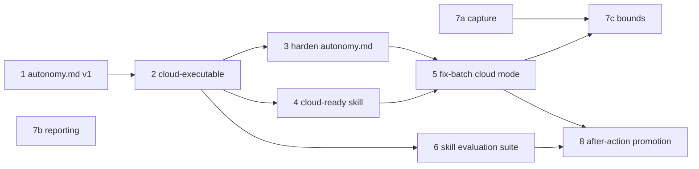

# Roadmap

**Status:** living document. Dated per entry rather than per file: a whole-file `Last updated` header was removed on 2026-08-27 (`chore-0066`) after twenty days reading 2026-08-07 over content that ran to 2026-08-27, with nothing checking it. Every claim below carries its own date, which is the date that can be checked against the thing it describes, and `git log -1 ROADMAP.md` answers what the header was answering without being able to drift.

The builder-facing execution plan: which skills get built and in what order. For the reader-facing narrative of what the kit offers, see [`docs/CATALOG.md`](docs/CATALOG.md). For atomic work in flight, see [`.quests/`](.quests/); for finished work, [`CHANGELOG.md`](CHANGELOG.md). Altitude model in the work-lifecycle section of [`AGENTS.md`](AGENTS.md).

Seeded 2026-07-23 from `docs/CATALOG.md`. Quest chains here stay at the 10,000-foot layer until it is their turn; only then are they decomposed into `.quests/` files.

---

## Current state

Measured 2026-11-24 at `zen/marjana-2026-11-24` `6162d00` (WS-A to WS-D landed) merged with WS-E's branch, which carries `main` at `220282a` (pull requests #109 to #116 merged). Counts are derived, not kept: `python3 scripts/install.py --dry-run` prints the draft list and every profile, and `ls .agents/skills` the total.

- **31 skills, 25 shipped and 6 drafts** (`metadata.status: draft`, placed only with `--include-drafts`): `agent-observatory`, `orchestrate`, `quest-tracker`, `research`, `sitrep` and `systematic-debugging`. The Marjana round added `orchestrate`, which a person starts by name, and `research` (`feat-0092`). Pull request #113 promoted `domain-language`, `grill`, `improve-architecture`, `retro`, `tdd` and `zen` (`feat-0084` to `feat-0089`).
- **The shipped skills**: `project-bootstrap` and `init-worktracking` set a repository up; `zen` routes; `grill` and `domain-language` align before planning; `new-quest` and the spec chain (`spec-author`, `spec-quality`, `spec-plan-readiness`, `spec-conformance`) turn decisions into contracts and tasks; `fix-batch` and `reconcile-worktrees` dispatch and land parallel work; `tdd`, `test-author`, `test-quality`, `verifier-agent` and `house-review` build and check it; `doc-author`, `doc-revise` and `doc-sync` keep the documents true; `pr-describe`, `agent-handoff` and `human-handoff` close and hand over; `retro` and `improve-architecture` learn from it.
- **Four swappable lenses** under `.agents/rules/` (`house-style`, `autonomy` with `A1` to `A11`, `review-quality`, `writing-for-agents`), plus the always-loaded `core.md`, and **seven opt-in hooks** under `.agents/hooks/`.
- **Distribution**: `install.py` (profiles `core`, `spine`, `all`; the default `spine` places 20 skills), `build-adapters.py` for Cursor and VS Code or Copilot, and the committed Claude Code marketplace under `.claude-plugin/`. `run-checks.py` is the acceptance command, and CI calls it.
- **13 approved behavioural contracts** under `docs/spec/`, several with amendments pending the author's re-approval.

This section says only what was true on its date; the next change to the kit makes it a record of that date.

## 2026-11-24 Marjana overhaul

A deep clean of context bloat and drift, planned and approved on 2026-11-24 in [the Marjana plan](docs/reviews/2026-11-24-marjana-plan.md) from [the inventory](docs/reviews/2026-11-24-marjana-inventory.md) and [the sources delta](docs/reviews/2026-11-24-sources-delta.md). Integration branch `zen/marjana-2026-11-24`, one pull request into `main`.

- **Groundwork** ([`chore-0099`](.quests/done/chore-0099-groundwork-for-the-marjana-overhaul.md)), **shipped 2026-11-24**: the plan, the maintainer's four decisions, and five workstream tasks.
- **WS-A Context and ledgers** ([`chore-0100`](.quests/done/chore-0100-marjana-context-and-ledgers.md)), **shipped 2026-11-24**: `AGENTS.md` cut to the rules, the ledgers archived by month under [`docs/history/`](docs/history/README.md), this section and the stale reader claims corrected.
- **WS-B Setup and align** ([`feat-0091`](.quests/done/feat-0091-marjana-setup-and-align.md)), **shipped 2026-11-24**: the per-repository setup file `docs/agents/zen.md` and its draft contract, the configure step in `init-worktracking`, both scaffolds user-invoked, and the task `mode` field.
- **WS-C Orchestrate and build** ([`feat-0092`](.quests/done/feat-0092-marjana-orchestrate-and-build.md)), **shipped 2026-11-24**: rule `D1` in the autonomy lens, the draft `orchestrate` and `research` skills, and the build and verify skills brought current.
- **WS-D Ship, learn and lenses** ([`feat-0093`](.quests/done/feat-0093-marjana-ship-learn-and-lenses.md)), **shipped 2026-11-24**: review stops after one fix round, `retro` ratchets and prunes, and the lenses keep documents honest.
- **WS-E Platform and gates** ([`feat-0094`](.quests/done/feat-0094-marjana-platform-and-gates.md)), **shipped 2026-11-24**: a "Done when" validator warning, a roadmap draft-status check, a description budget that counts what Claude Code loads, a hermetic home for the test gate, undecodable-name tests, and one shared link reader (`feat-0090`).
- **Integration** ([`feat-0095`](.quests/done/feat-0095-marjana-integrate-verify-and-ship.md)), **closed 2026-11-24**: independently verified (`pass`), the retro's ten proposals recorded for approval, and one draft pull request into `main` for the maintainer to merge.
- **Recorded, not built this round**: retro proposals `R-003` and `R-004` stay owed. Whether the drafts `quest-tracker` and `agent-observatory` are Tier A skills or the maintainer's own tooling is decided at their promotion.

## Shipped and archived sections

Moved verbatim to [`docs/history/roadmap-2026.md`](docs/history/roadmap-2026.md) on 2026-11-24, headings unchanged, so a quest `parent:` citing one still finds it there:

- The 2026-11 overhaul, with its subsections "Drafts the overhaul added, and what promotes each", "Links to convert on promotion", "Carried forward from the overhaul" and "Release readiness (2026-11-23)". The overhaul landed in pull request #98 and reached `main` in #109.
- Kit hardening (from the 2026-07-25 review pass).
- Kit mechanics hardening (from the 2026-07-27 review pass).
- Kit coherence hardening (from the 2026-08-18 review pass).
- The full text of every shipped item in Campaign A and Campaign B; each keeps a one-line stub below in its original number.

**Carried forward from the 2026-11 overhaul**, still open: `review-quality.md` folds in only the in-scope parts of the upstream `moonray/repoprompt-workflows` drift (the revalidation gate for `fixed`, futility classification and frozen-baseline re-anchoring are not reconciled), and `review-depth`'s path-scope measurement mismatch lives in `house-review`'s rationale reference.

---

## Forward plan

Ordered by effort-to-value. Each item is one skill (a Quest chain). Strike through when shipped.

### Campaign A: broadly shareable (the public kit)

1. ~~**`project-bootstrap`.** The umbrella front door: language-aware scaffold (gitignore, editorconfig, linter/formatter, license, README stub) that then calls `init-worktracking`.~~ **Shipped**; full entry [archived](docs/history/roadmap-2026.md#epic-a-broadly-shareable-the-public-kit-shipped-items).
2. ~~**`pr-describe`.** Draft a PR body and changelog entry from a branch's diff, in the target repo's own changelog format (draft-only, never touches GitHub).~~ **Shipped**; full entry [archived](docs/history/roadmap-2026.md#epic-a-broadly-shareable-the-public-kit-shipped-items).
3. ~~**`house-review`.** House-style review with an explicit rubric and severities, composing the swappable [`review-quality`](.agents/rules/review-quality.md) lens (moonray's quality-lens pattern).~~ **Shipped**; full entry [archived](docs/history/roadmap-2026.md#epic-a-broadly-shareable-the-public-kit-shipped-items).
4. **`ci-scaffold`** (hold until used twice). Generate CI (lint + test + build + release) matched to the detected stack.
5. **`release-cut`** (hold until used twice). Version bump, changelog roll-up, tag, notes.
6. ~~**Fold in `doc-author` / `doc-revise`** from `zen-solutions-studio`.~~ **Shipped**; full entry [archived](docs/history/roadmap-2026.md#epic-a-broadly-shareable-the-public-kit-shipped-items).
7. ~~**Fold in `agent-handoff` / `human-handoff`** (already portable by design).~~ **Shipped**; full entry [archived](docs/history/roadmap-2026.md#epic-a-broadly-shareable-the-public-kit-shipped-items).
8. **Kit-wide skill evaluation** (recurring). Systematically exercise and evaluate every shipped skill rather than trusting the one dogfood that blessed it, then refine from what the pass finds. Each skill was blessed on a single real use, which proves it works once and leaves other branches unexercised. The three named at the outset, `verifier-agent`'s `blocked` verdict, `test-author`'s characterization mode, and `spec-plan-readiness`'s blocking paths, were all exercised on real triggers on 2026-07-27 (`feat-0024`, `feat-0027`, `feat-0028`) and each run is recorded. The recurring question is what to exercise next. Define what "evaluated" means (which behaviors must be observed, and what evidence counts), run the pass, and record per-skill findings as tasks. Decide as part of the work whether the result is a written evaluation protocol, a reusable `skill-eval` skill, or a fixture-based regression suite under `tests/`; do not presuppose the artifact. This is the natural consumer of the spine itself: specify it with `spec-author`, verify each skill with `verifier-agent`. A first read-only pass ran on 2026-07-25 and its findings are filed under [Kit hardening](#kit-hardening-from-the-2026-07-25-review-pass); that pass covered structure, status claims, and cross-references and deliberately did not exercise any skill's behavior. A second pass on 2026-07-27 did exactly that, going at what each procedure does when run, and found two blockers no reading pass had; its findings are filed under [Kit mechanics hardening](#kit-mechanics-hardening-from-the-2026-07-27-review-pass). **Absorbed 2026-08-07 by [Campaign E](#campaign-e-delegated-execution-cloud-and-unattended-work) item 6**, which answers the artifact question this item deliberately left open: a fixture-based regression suite under `tests/`, rather than a written protocol or a `skill-eval` skill. The reason it can be answered now is that the consumer arrived. An unattended batch has no human reading each run, so "exercise a skill and judge the result" stops being available and the only evaluation that survives delegation is one a command can run. The recurring question of what to exercise next stays live here; the mechanism moves there.

9. ~~**`tracker-links`: GitHub issue linking.**~~ **Shipped**; full entry [archived](docs/history/roadmap-2026.md#epic-a-broadly-shareable-the-public-kit-shipped-items).
10. **Azure DevOps work-item linking** (hold until an ADO board has been used on real work). The same idea against Azure Boards, which uses `AB#{ID}` and supports state transitions (`Fixed AB#1234` moves the item to the Resolved category). Deliberately deferred rather than built alongside GitHub: the kit has no ADO project to exercise it against, and shipping an unexercised integration is the cold ship the contribution bar forbids. Two things make it cheaper than it looks when its turn comes. The `external` field holds the platform's own token verbatim, so an `AB#1234` value needs no new field or translation layer. And the hierarchy already matches: Azure's Epic to Feature to User Story to Task is the work-altitude model this repo already uses. Note before building: Microsoft ships a supported [Azure DevOps MCP server](https://github.com/microsoft/azure-devops-mcp), so the right shape may be composing what an adopter already has rather than shelling out to `az boards`. Decide that with evidence, not in advance.

### Campaign B: contract-driven delivery (the agent-workflow spine)

1. ~~**`spec-quality`.** A reusable quality gate for scenario-based specifications: keep contracts observable, non-redundant, grounded in repository context, traceable through stable scenario IDs, and free of implementation planning. Report explicit blockers for ambiguity, uncovered goals or surfaces, and unresolved questions.~~ **Shipped**; full entry [archived](docs/history/roadmap-2026.md#epic-b-contract-driven-delivery-the-agent-workflow-spine-shipped-items).
2. ~~**`spec-author`.** Draft a persistent, executable `SPEC.md` from a raw idea before task decomposition: outcomes, anti-goals, architectural constraints, prior decisions, and mechanically testable verification criteria. It composes `spec-quality`; planning and specification work are read-only for implementation surfaces, and an explicit human approval state is required before `new-quest` consumes a specification.~~ **Shipped**; full entry [archived](docs/history/roadmap-2026.md#epic-b-contract-driven-delivery-the-agent-workflow-spine-shipped-items).
3. ~~**`spec-plan-readiness`.** Gate implementation on an approved specification plus an ordered, repository-grounded plan. Block tests, code, and delegation until scenarios, tasks, validation, risks, rollback notes, task-to-scenario traceability, and a first safe task are all explicit.~~ **Shipped**; full entry [archived](docs/history/roadmap-2026.md#epic-b-contract-driven-delivery-the-agent-workflow-spine-shipped-items).
4. ~~**`test-quality`.** A reusable test-quality lens for choosing the lowest faithful test layer, naming the plausible defect each test protects, testing the real bug population, asserting meaningful observable outcomes, and handling fixtures, mocks, diagnostics, and trust boundaries deliberately.~~ **Shipped**; full entry [archived](docs/history/roadmap-2026.md#epic-b-contract-driven-delivery-the-agent-workflow-spine-shipped-items).
5. ~~**`test-author`** (promoted from the former Epic B). Derive focused acceptance tests from approved specifications and task criteria, while retaining characterization-test support for legacy code with no coverage. Compose `test-quality` and run between implementation and reconciliation so test evidence is part of the core workflow.~~ **Shipped**; full entry [archived](docs/history/roadmap-2026.md#epic-b-contract-driven-delivery-the-agent-workflow-spine-shipped-items).
6. ~~**`spec-conformance`.** Audit every approved scenario and public-surface element against code and test evidence, producing a positive conformance matrix of `Conformed`, `Diverged`, or `Not-built` items and an explicit unreconciled set. It reports, never repairs, implementation divergence.~~ **Shipped**; full entry [archived](docs/history/roadmap-2026.md#epic-b-contract-driven-delivery-the-agent-workflow-spine-shipped-items).
7. ~~**`verifier-agent`.** Independently test an implementation against its approved specification and task acceptance criteria before reconciliation. It composes `spec-conformance`, produces structured pass, fail, or blocked evidence, runs the declared commands, and never edits the implementation it verifies.~~ **Shipped**; full entry [archived](docs/history/roadmap-2026.md#epic-b-contract-driven-delivery-the-agent-workflow-spine-shipped-items).
8. **`user-testing`** (hold, conditional on user-facing work; reasoning restated 2026-08-05). Drive rendered UI workflows against throwaway data, inspect screenshots plus console and network state, and record user-visible defects that automated tests and contract conformance miss. Mark the closeout blocked when real workflow testing cannot run, rather than silently skipping it. **Reviewed against the upstream skill on 2026-08-05 and still held.** Its transferable content is two ideas: run only against a throwaway data location, never real environment data, and mark a closeout blocked rather than silently skipping when workflow testing cannot run. Both are worth having and neither justifies a skill for a kit whose users are mostly not building UI. The calculus that changed is tooling availability, not need. **Trigger to revisit:** the first piece of real user-facing work built with this kit, at which point author it against that work rather than in the abstract.
9. ~~**`doc-sync`.** Detect documentation drift caused by code changes or audit a documentation set, distinguishing current-state docs from human-owned contracts. Default to a code-grounded dry run; require explicit approval before updating current-state documentation and never silently rewrite contract documents. Keep it distinct from `doc-author` and `doc-revise`.~~ **Shipped**; full entry [archived](docs/history/roadmap-2026.md#epic-b-contract-driven-delivery-the-agent-workflow-spine-shipped-items).
10. ~~**`review-depth`.** Select quick, standard, or deep review from deterministic signals: change size, directory spread, severe risk flags, blast radius, and documentation-only scope. Compose it with `house-review` so review effort matches risk and an explicit user choice always overrides detection.~~ **Shipped**; full entry [archived](docs/history/roadmap-2026.md#epic-b-contract-driven-delivery-the-agent-workflow-spine-shipped-items).
11. **`maintainability-review`** (hold; reasoning replaced 2026-08-05). An optional, strict structural review lens for unnecessary indirection, file sprawl, spaghetti growth, boundary leaks, and missed simplification. **"Hold until used twice" is no longer the binding reason.** Two better ones replace it. First, upstream does not author this lens either: it syncs it from `cursor/plugins` (the "thermo-nuclear" code-quality review, MIT), so adopting it makes this kit a third-hand vendor, which `NOTICE` already anticipates. Second, and decided by inspection rather than assumed now that `feat-0035` has landed: **`review-depth`'s `deep` tier absorbs most of the need**, and since 2026-11-23 (`feat-0078`) that tier is `house-review`'s `deep` depth, which kept the rule. It sets three knobs and states it sets nothing else, and one of them is that every category in the `review-quality` lens is considered explicitly and recorded as applied or as one line of "not applicable, and why". Category 5 of that lens is already readability and maintainability (naming, structure, dead code, duplicated logic, needless complexity). So a `deep` review already sweeps this ground and cannot silently skip it. What a dedicated lens would add is strictness beyond one rubric line, not coverage where there was none. **Concrete trigger to revisit:** a real `deep` review whose findings show category 5 is too coarse for the structural problem in front of it. Until that happens the marginal value is small and the vendoring cost is real. If it does happen, author one against the observed gap rather than vendoring a third-hand lens.
12. ~~**Decision log (v1, task-file only).** Have each worktree agent record its non-recoverable decisions (rejected alternatives, deliberately open seams, falsified task premises) in its own task file, and have `pr-describe` surface them. Deliberately excludes the spec-sibling rollup (`docs/spec/<name>.decisions.md`, consumed by `new-quest`) until v1 proves the entries are worth reading, and carries an explicit kill criterion so the convention cannot survive by default.~~ **Shipped**; full entry [archived](docs/history/roadmap-2026.md#epic-b-contract-driven-delivery-the-agent-workflow-spine-shipped-items).
13. **Enforcement hooks, then telemetry** (was `telemetry-guard`; reframed 2026-08-05). The original item was scoped as run-state telemetry, and reading the upstream sources showed that was second in line rather than wrong. Every rule this kit enforced was prose, which holds only while the model keeps it in context and fails for rules that must fire when nobody is thinking about them, so the higher-leverage first move was enforcing the spine already built.
    - ~~**Phase 1: the `.agents/hooks/` module.** A portable stdlib-Python guardrail protocol with two shapes, a *reminder* that injects context and never blocks and a *gate* that blocks only when the condition is decidable from the payload rather than interpreted from prose.~~ **Shipped** (`feat-0038` established the module, its contract, three-harness wiring and opt-in installation, seeded with `delegation-reminder`; `feat-0039` added `spec-conformance-gate`, the first gate. Both adapted from `repoprompt-workflows` (Balarama Bosch, MIT). Two findings worth carrying forward: the dogfood caught the hook silently inert on `Agent` delegations and a `python3` registration that on Windows resolves to the Store alias and fails forever without surfacing, both being the same failure shape, installed and correct-looking and doing nothing; and the faithful port of the gate would have been inert here, since this kit's spec lifecycle is `draft` then `approved` and stops, so it gained a second trigger on task closure. A guardrail that cannot fire in the repository that ships it is one nobody has ever seen work).
    - **Phase 2: telemetry and bounds** (not built; **absorbed 2026-08-07 by [Campaign E](#campaign-e-delegated-execution-cloud-and-unattended-work) item 7**). Structured lifecycle events, retry and implementor/verifier-cycle limits, time or optional compute budgets, repeated-work detection, and a clear stop signal on a bound violation. Phase 1 deliberately shipped none of it, because none is needed to make a reminder fire or a gate block, and the repeated-work half now has its own item below (`feat-0042`) since it depends on a finding signature rather than on run state. The reason it stayed unbuilt is the reason it moves: telemetry has no consumer while a human is watching every run, and Campaign E item 5 is what first creates batches nobody is watching. It is held behind that item there rather than sequenced here.
    - **Deferred within phase 1: `test-quality-reminder`.** Upstream's Stop-gate hook, which blocks stopping when a test file was edited without both a suite run and a `test-quality` invocation after it. The edit-run-vet-stop ordering is worth having. Its implementation carries several hundred lines of shell-command parsing to decide whether a `Bash` call was a test run, with wrapper-word stripping and package-manager subcommand exclusion, and that heuristic pile is not worth importing before the module has proven itself. Revisit once a gate has run unattended for a while.
    - **Deferred within phase 1: the lifecycle coverage gaps** (audited 2026-08-27, none built). A stage-by-stage audit found that of ten lifecycle stages, exactly one has a hook firing at it, and that the module's only *gate* is registered for Codex and OpenCode and not in this repository's own [`.claude/settings.json`](.claude/settings.json). Four candidates came out of it and **all four are held deliberately, because a module with one gate that has never fired in anger here does not need four more at once**: registering the existing `spec-conformance` gate for Claude Code (no new code, and reserved to the author by the committed-hook exception in `AGENTS.md`); a `PreToolUse` **gate** on a destructive `git reset --hard` or `git checkout --` inside an agent worktree, decidable from the payload, with the `merge --ff-only` recovery as its stated escape; a `PreToolUse` **gate** on a commit message carrying a `Co-Authored-By` trailer, the one rule here with a measured cost in hours; and a dispatch-time **reminder** injecting the nine-field report contract, which must be a reminder because whether a prompt carries the contract is not decidable from the payload. **Trigger to revisit:** the first of these registered and run for several real waves, measured rather than assumed. Coverage of the path that ships them is [`chore-0067`](.quests/done/chore-0067-the-with-hooks-placement-path-is-covered-by-no-test-and-no-gate.md).
    - ~~**An instruction-provenance reminder at session start.**~~ **Shipped 2026-11-23** ([`feat-0081`](.quests/done/feat-0081-name-the-instruction-files-no-commit-vouches-for.md)), out of order and on purpose: it answers an attack with no patch rather than a coverage gap. A planted `AGENTS.md` or `CLAUDE.md` is loaded before the agent reads anything, so `A10` can only apply once something names it. The hook reads git's index itself, because running `git` in a planted folder would execute that folder's `.git/config`. Opt-in like every other hook; registering it in this repository's committed settings is still the author's decision.
14. **`context-sync`** (hold until used against one real integration). Ground an agent in a narrowly defined live source, such as a schema or API contract, with recorded source, version or timestamp, authority level, failure behavior, and reproducible provenance for verification. Do not ship a generic MCP wrapper without field iteration.
15. ~~**Evidence gate and stable finding signature.** Require every review finding to carry a resolvable citation (path, line range, symbol, and an exact quote of the cited code), and drop any finding whose quote does not resolve against the file on disk. Give each finding a stable signature (severity, normalized path, summary, area id) so findings can be deduplicated across lenses and counted across runs.~~ **Shipped**; full entry [archived](docs/history/roadmap-2026.md#epic-b-contract-driven-delivery-the-agent-workflow-spine-shipped-items).
16. ~~**Delegate evidence contract for `fix-batch`.** Require a fixed field set from every worktree agent's report (task id, covered scenarios, files changed, tests, the validation command **and** its verbatim result, findings in the evidence shape above, recommended next step), and block acceptance when a field is missing. Reject transcript-style reports.~~ **Shipped**; full entry [archived](docs/history/roadmap-2026.md#epic-b-contract-driven-delivery-the-agent-workflow-spine-shipped-items).
17. **Repeat detection and futility classification.** After N failed fix attempts or M observations sharing a finding signature, force a classification into `false_positive`, `core_issue`, or `futility`, and defer a futile finding as its own task rather than retrying it. Scoped as [`feat-0042`](.quests/feat-0042-repeat-and-futility-classification.md). It was genuinely blocked on item 15, since without a stable signature there is nothing to count; item 15 shipped on 2026-08-05, so the signature now exists and this is unblocked. **The only preventive item in this group**: unlike 15 and 16, which each fix a failure this repository has already observed, this one fixes a predicted one, so it carries an explicit kill criterion. If no batch trips the trigger in the first several real runs, reconsider rather than keep it by default.
18. ~~**Provenance convention for folded-in material.** Record source URL, license, author, retrieval date, and a SHA256 digest of the retrieved content for anything adapted from an external source, and add an on-demand check that re-fetches and reports drift.~~ **Shipped**; full entry [archived](docs/history/roadmap-2026.md#epic-b-contract-driven-delivery-the-agent-workflow-spine-shipped-items).
19. **Drift sensors that run outside the change lifecycle.** Every sensor this kit owns fires only when something invokes it: `validate.py` and `validate-skills.py` run in CI on a change, `doc-sync` runs when a human asks, and `check-provenance.py` is deliberately outside required CI because it needs network. Nothing watches for drift *between* changes. Added 2026-08-18, and the argument for it is the review pass itself: three of its findings (the shipped task template diverging from the kit's own, `autonomy.md` losing every inbound reference, a tier justification naming a skill that never mentioned the file) are drift that accumulated while every gate stayed green, and each was found by a human reading rather than by anything that runs. The framing is Birgitta Böckeler's guides and sensors (`martinfowler.com/articles/harness-engineering.html`), where a continuously running drift sensor is named as the gap current practice has not filled. Do not presuppose the artifact: a scheduled workflow, a `drift-watch` skill an adopter can run, and a widened `run-checks.py` gate are all candidates, and which one is right depends on whether the check is cheap and deterministic or needs judgment. **Acceptance bar: it must find something on a repository nobody has just reviewed.** **Scoped 2026-09-01 as [`feat-0065`](.quests/feat-0065-a-scheduled-sensor-for-the-drift-checks-that-only-run-when-somebody-remembers.md)**, which picks the scheduled workflow from the three candidates and leaves the other two unbuilt. The narrowing is recorded rather than assumed: `install.py --check` was measured on 2026-09-01 to be undecidable in CI, since the manifest it reads is gitignored and per-machine, so a fresh clone exits 2 unconditionally, which leaves `check-provenance.py` as the one sensor with no other trigger at all. The class is no longer only the 2026-08-18 argument: [`bug-0063`](.quests/done/bug-0063-the-security-policy-denies-the-prompt-injection-rule-the-kit-ships.md) found `SECURITY.md` denying a rule the kit ships, wrong for five days across a green tree, because no gate reads a prose claim and nothing runs between changes.
20. **A context and altitude lens** (hold until the `autonomy.md` wiring question is settled). Every source read in the 2026-08-18 research names context management as the primary harness lever, ahead of tooling and orchestration. This kit's strongest context-engineering asset is the agent reading protocol in `AGENTS.md` (read this file, your one task file, and only the files named in `touched_files`), and it lives in the scaffold the kit **emits** rather than as a lens the kit's own skills compose. A fourth module beside `house-style.md`, `review-quality.md` and `autonomy.md` would give skills a shared answer to what an agent reads, when to reset rather than continue, and what a subagent returns instead of its transcript. **Sequenced deliberately last:** `autonomy.md` was authored as the third lens and no skill composed it, so adding a fourth before that was resolved would have repeated the mistake rather than fixed it. **The gate is met as of 2026-08-19** ([`feat-0048`](.quests/done/feat-0048-wire-the-autonomy-lens-into-the-skills.md)): five skills now compose `autonomy.md`, each naming the specific rule it takes, and `validate-skills.py` fails a self-declared lens with no inbound reference, so the condition this hold names cannot silently recur. **The hold is recorded as unblocked, not discharged** (2026-08-27, `chore-0066`): whether a fourth lens is now wanted is a separate judgment and it is the author's.
21. ~~**Approval bound to the text approved.** A spec's `status: approved` said a person agreed to a contract and never said which text, so an approved spec edited afterwards still read as approved and anything verified or decomposed against it inherited an approval nobody gave.~~ **Shipped**; full entry [archived](docs/history/roadmap-2026.md#epic-b-contract-driven-delivery-the-agent-workflow-spine-shipped-items).

### Considered and declined (2026-08-05)

Recorded so the question is not reopened every time someone reads [`repoprompt-workflows`](https://github.com/moonray/repoprompt-workflows). Each was examined against this kit and rejected for the stated reason, not overlooked.

| Declined | Why |
|---|---|
| `track-work` (upstream skill) | Drives GitHub issues and a project board through `gh`. This kit's tracking is deliberately local, which is what keeps an agent's reading list short and works with no network and no account. `tracker-links` already covers the one direction that matters. |
| `Backlog` workflow | Triages tracked issues into worktrees. `new-quest` plus `fix-batch` plus `reconcile-worktrees` already is this, authored against this kit's `.quests/` model rather than RepoPrompt CE's. |
| `Spec` / `Test` / `Loop` / `Deep-Review` workflows, as whole artifacts | The discipline in each was already extracted into portable skills (`spec-author`, `test-author`, the spine, `house-review`). Taking the orchestration shells too would import RepoPrompt CE runtime assumptions for no gain. Specific mechanisms from them are taken individually as items 15 to 17. |
| Upstream's installer model | Symlink-only and macOS-only. `install.py`'s copy-on-Windows, symlink-on-POSIX, CONFLICT-detecting, manifest-reversible model is the more considered one and already ships. |

### Campaign C: semi-scalable (teams and clients)

1. **`repo-explainer`.** A "start here" guided tour of an unfamiliar codebase.
2. **`sop-drafter`.** Turn a described workflow into a documented SOP.
3. **`security-audit`.** Repeatable dependency and secret scan with a written summary.
4. ~~**`adr`.** Architecture decision records / decision log.~~ **Covered** by the shipped `domain-language`, which writes an ADR when a decision is hard to reverse (noted 2026-11-24).
5. **`systematic-debugging`.** A phased root-cause procedure: reproduce, isolate, form and test one hypothesis at a time, then name the cause before proposing a fix. Added 2026-08-18 from the review pass, which found it to be the largest single hole in the workflow: the kit bootstraps, specs, decomposes, dispatches, tests, verifies, reviews, reconciles and documents, and has no skill for working out *why* something is broken. Diagnosis is both the most common real task and the one where an unguided agent most reliably guesses, and it is the natural upstream of `new-quest`, since today a bug report becomes a task file with no step in between that establishes the cause. Prior art: the four-phase `systematic-debugging` skill in Jesse Vincent's `superpowers` (`github.com/obra/superpowers`, MIT), which occupies exactly this slot in a comparable library. Fold in under the provenance convention rather than writing from scratch, and hold the contribution bar: it ships only after it has been used on a real defect here. **Contract drafted 2026-08-18** as [`docs/spec/systematic-debugging.md`](docs/spec/systematic-debugging.md), 13 scenarios, **approved by the author on 2026-08-19** (`e492b10`), and **amended 2026-08-29 to 15** by `chore-0078`, which settled both of its Open Questions before anything was built against it: instrumentation lives only in a copy the run made for the purpose (`S-014`), a target offering no way to make one is answered rather than refused (`S-015`), and the default investigation bound stays out of the contract as a tuning value; it departs from the prior art in two decided ways, ending at a diagnosis that feeds `new-quest` rather than at a fix, and returning a deterministic verdict rather than enforcing a gate. Its verdicts are now the kit's single classification vocabulary, and item 17 was retargeted to consume them. **Built 2026-08-29** by `feat-0061` and shipped as a **draft**, so no profile places it and no adopter receives it: fifteen structural tests, a conformance matrix at 15 of 15, and a provenance block pinning the upstream bytes. **Dogfooded 2026-08-29** by `feat-0062`, on the observatory's `database is locked` failure, and **it stays a draft**. The run produced a real diagnosis and the procedure demonstrably changed the answer, killing a wrong cause that reading the code alone had produced. It also produced a **second** wrong cause that passed the skill's own confirming-observation test, and an independent check refuted it: the trial the run called confirming was raising a SQLite busy timeout, which ends any wait whatever is waiting, so it was consistent with the hypothesis rather than a test of it. Five corrections went into the skill as a result, each asserted so it cannot be silently deleted, and the mutation set went to 25 of 25 killed. A skill whose first real use refuted its own output does not go in front of adopters on the strength of that use, so promotion waits on `feat-0063`: one run by a session that did not write it, on a defect it did not choose, whose diagnosis survives an independent check.

6. **`quest-tracker`** (draft). Run a season of project work from one shared tracker page: phases of steps that each carry what to do, why, and what closes it, with line ticks, facts, a session log with screenshots, a quest chain, a burndown, and a People panel, all drawn from one data block and saved in the page's own database, so the author, collaborators, and agent sessions plan and log from one surface. **Drafted 2026-10-20** by [`feat-0072`](.quests/done/feat-0072-the-quest-tracker-skill-as-a-draft.md) from the run sheet that carried a client launch through October 2026, which is the real use the contribution bar asks for, and which the bundled template generalizes. It was first built on the kit as it stood before the 2026-10 refresh and rebuilt on the refreshed kit the same day, adding a script for the deterministic parts (filling and checking the data block, building a claim from a command's real output) and, in template 1.2.0, a "Waiting on you" strip and a mark on every tick saying what it rests on. **Claim-and-verify**: an agent never ticks, it writes a claim carrying the command it ran and that command's verbatim result as two fields, and a person verifies the claim and ticks the step, which is the autonomy module's `A4` and `A7` applied to a surface people read as a record of checked work. That half has not run on real work, so the skill stays a draft until a season has run on it. **Harness-bound by nature, and declared as such**: it needs a host that publishes a page with a shared database, which today is Claude artifacts, named in the skill's `compatibility` field rather than hidden in its body. It sits beside [Campaign F](#campaign-f-sangha-multi-human-multi-agent-workspaces)'s property, that no collaborator is silently missing what the others see, without being an Campaign F item: it is one person's working surface shared with collaborators, not a governed workspace. **A portfolio index above the trackers** ([`feat-0074`](.quests/feat-0074-a-portfolio-index-above-the-season-trackers.md), decided 2026-10-22) belongs here rather than in Campaign E #7d's cross-repository view, because a season spans repositories and keeps its state outside git; each row links to the repository's board where one exists. **Closing out session hand-over notes** ([`feat-0075`](.quests/feat-0075-close-out-and-lint-session-hand-over-notes.md), filed 2026-10-22, cherry-picked 2026-11-24): every durable fact in a note moves to the repository or the tracker at close, and a lint names what never moved.

### Campaign D: personal (stays OUT of the shared kit)

The Content OS pipeline (`produce`, `clip-machine`, `repurpose`, `video-editing`, `video-cutting`, `episode-brief`, `youtube-transcript`, `idea-discovery`) stays in `zen-solutions-studio` as portfolio demos, not plug-and-play kit skills.

### Campaign E: delegated execution (cloud and unattended work)

Added 2026-08-07. The goal is to move the large majority of development into cloud agent sessions rather than a remote desktop, across this repository and several others, so work continues away from the machine. Everything in this campaign follows from two properties of such a session, and neither is a limitation to work around: they are what the epic is designed against.

**A cloud session sees only what is committed.** This kit's own skills are installed at user scope by [`install.py`](scripts/install.py), and nothing here places them anywhere a clone would carry. So a cloud session that clones this repository has none of them loaded, and the repository that builds the kit is the one repository where the kit is absent. (This sentence opened with the measurement "`git ls-files .claude` returns nothing; the directory holds only `worktrees/`" until 2026-08-27, `chore-0066`. It stopped being true within a day of being written: item 2(b) below committed [`.claude/settings.json`](.claude/settings.json) on 2026-08-07 precisely so the reachability hook would reach these sessions, which the conventions section of [`AGENTS.md`](AGENTS.md) records as the kit's one committed hook registration and the one place it activates a hook on someone's behalf. The measurement moved; the conclusion it supported did not, so the conclusion stands on the user-scope install alone.) Anthropic's 2026 agentic coding trends report names this the delegation gap and puts structured intent specifications in the safeguard position, which is the spine Campaign B already built.

**A cloud session cannot stop and ask.** Anthropic's own best-practices guidance makes this the deciding factor and answers it in one line, "give Claude a check it can run". Every interactive check this repository has is a person reading output, so the first item below turns the ones that matter into a command.

The gap exists only for the two global-scope harnesses. Claude Code and OpenCode discover skills from a global directory (`~/.claude/skills`, `~/.agents/skills`), while Cursor and VS Code get repository-level adapters from [`build-adapters.py`](scripts/build-adapters.py); neither adapter tree is committed here, which is a separate question held below rather than solved here.

**Design bar:** this maintainer's multi-repo workflow first, generalize after. The portability contract in the portability-contract section of [`AGENTS.md`](AGENTS.md) is a hard gate at ship time for the two items that generalize (4 and 5 below), and deliberately not a design constraint on items 1 and 2, which are allowed to be about this repository. Harnesses in scope: Claude Code, Codex, Cursor, Windsurf.

**Kit-wide autonomy ceiling.** An unattended agent pushes to a `claude/` branch and opens a **draft** pull request carrying its evidence report. It never merges. This is the ceiling for everything in this campaign and is not an item's to relax.

1. **`autonomy.md` v1** (item 2a of the original decomposition, and deliberately first). **v1 authored 2026-08-07, not blessed**: it ships as a module and travels with the skills, but the contribution bar holds, so it stays unstruck until item 2's run has exercised it and item 3 has hardened it from what that found. **Ten rules as of 2026-08-27**, `A1` to `A10`, every one carrying its citation, plus three candidates named and held for want of one. Authored with eight; `A9`, verify the commit you are working from, was added by `bug-0043` from what the first real unattended run found, which is item 3 of this campaign doing exactly what it exists for. **`A11` added 2026-11-23** ([`feat-0082`](.quests/done/feat-0082-an-agent-may-not-edit-its-own-judge.md)): do not edit the judge, applying to every run like `A10`, cited by two internal exercises and by published measurements of models editing the tests that judge them. The fourth held candidate, instructions embedded in material a skill reads, was added 2026-08-08 by `feat-0047` after a recorded four-pass search came back empty, and discharged as `A10` on 2026-08-27 by `chore-0071`, which accepted an external incident as the citation rather than waiting for either trigger it had named. A fourth swappable module at `.agents/rules/autonomy.md`, beside [`house-style.md`](.agents/rules/house-style.md) and [`review-quality.md`](.agents/rules/review-quality.md), organized around one named principle with the rules as its applications: **detect and report, never rewrite; the failure mode must be inaction.** This is a consolidation, not an invention. The principle is already applied in four independent places in this kit and named in none of them: [`doc-sync`](.agents/skills/doc-sync/SKILL.md) states it outright, [`house-review`](.agents/skills/house-review/SKILL.md) is report-only by protocol rule 6, `install.py --check` reports a stale copy and never refreshes it, and [`check-provenance.py`](scripts/check-provenance.py) reports drift rather than syncing, which `feat-0043` chose deliberately against upstream's in-place rewrite. **Every rule in v1 carries a citation** to where it was already exercised: a `file:line`, a task id, or a recorded incident. A rule that cannot be cited does not go into v1 and waits for item 3. That is [`feat-0040`](.quests/done/feat-0040-evidence-gate-and-finding-signature.md)'s evidence gate applied to a rules module, and it exists because an invented rule reads exactly like a consolidated one and nothing else would catch the difference. The verified candidate pile: the sandbox rule stated explicitly rather than implied by isolation; never modify a file outside declared scope; verification is run by someone other than the agent whose work is verified; the validation command and its verbatim result as two separate fields, with no gap closed by inference from prose; disclose opportunistic work, grounded in two failures observed in `fix-batch` runs, an undisclosed test method that never existed in the repository's history and an undisclosed opportunistic bug fix; a partial audit is never reported as a whole one; never overwrite a file you did not create, report the conflict and stop; open a draft pull request and never merge your own work. [`bug-0018`](.quests/done/bug-0018-reinstall-destroys-an-adopter-edited-lens.md) is the same principle failing in practice and is worth citing as such. Ordered before item 2 because running a cloud session with no autonomy module is the highest-risk configuration in this campaign.

2. **Make this repository cloud-executable.** One Quest chain, kept whole rather than split, because its three parts are only worth anything together: a session that can check its work but cannot see the skills is as stuck as one that can see them and cannot check. Three parts.
    - **(a) The acceptance command.** One committed script, standard library Python, wrapping the seven gates in [`checks.yml`](.github/workflows/checks.yml), with CI calling it instead of restating them. One rule, two callers, per the precedent [`chore-0029`](.quests/done/chore-0029-third-copy-of-the-link-rule-in-ci.md) set, where an inline copy of the link rule drifted and let a correctly quoted `CHANGELOG.md` entry pass `--strict` and fail CI. `AGENTS.md` names the script and states in these words that passing it is **necessary but not sufficient**, because CI runs three operating systems by two Python versions and the script runs one.
    - **(b) The bootstrap hook.** A `SessionStart` reminder, a new member of the [`.agents/hooks/`](.agents/hooks/README.md) module following the reminder shape and the opt-in installation contract [`feat-0038`](.quests/done/feat-0038-hooks-module-and-delegation-reminder.md) set. Detect and report; it never writes. Registered with a `startup` matcher so it does not fire on resume, clear, compact, or fork. The mechanism is a repository-committed hook rather than an account-level environment setup script, because a setup script's output is filesystem-snapshotted for roughly seven days, so an edited skill could be served stale silently, which is the exact silent-wrong-result class this repository keeps getting bitten by. What it checks is **reachability** across project and user scope, with **no environment detection at all**: there is no shared cloud-detection signal across the three harnesses, so explicit detection would mean three detections for one question, which fails the portability contract.
    - **(c) The proof.** Run [`bug-0018`](.quests/done/bug-0018-reinstall-destroys-an-adopter-edited-lens.md) end to end through `claude --cloud` under `autonomy.md` v1. **Chosen on 2026-08-07 over `feat-0042`, which this item was first drafted against, because that task's acceptance cannot see its own work**: it edits three skill-body files, and `validate-skills.py`, `validate.py --strict`, and the test suite all pass whatever the prose says, so a session could produce hollow text and clear every gate. `bug-0018` is P1 data loss in shipped code whose acceptance requires a regression test that **fails against the unfixed `install.py`**, which is an outcome a session cannot fake. A proof run whose check cannot distinguish real work from plausible work does not prove the thing this Feature exists to establish. `feat-0042` stays in the backlog, unchanged. **Repointed 2026-08-20** (`chore-0051`): `bug-0018` closed on 2026-08-08, one day after the runbook that dispatches it was written, so the target was spent and the run named here could not be performed, and nothing reported it because `validate.py --strict` passes precisely when the link resolves into `done/`. [`cloud-executable.md`](docs/spec/cloud-executable.md) amended `S-017` and `S-018` to name [`bug-0020`](.quests/done/bug-0020-check-unknown-remedy-is-wrong-for-the-adopted-lens.md) instead, chosen **against the criterion in this paragraph rather than a weakened one**: it is a defect in `scripts/install.py`, so `S-018`'s "the unfixed `install.py`" stays literally true of it, and its first acceptance criterion already required a test failing against the current message.
    - **Acceptance, and it was met on 2026-08-20.** The bar is unchanged in every word except the target: the proof task lands via a cloud session that opened a draft pull request whose report meets the nine-field evidence contract from [`feat-0041`](.quests/done/feat-0041-delegate-evidence-contract-for-fix-batch.md), with the acceptance script's verbatim output in it and the regression test shown failing before the change and passing after. `bug-0020` did exactly that, and is the first work in this repository implemented end to end by an unattended cloud session: branch `claude/bug-0020-unknown-remedy-lcqb52`, pull request #41 opened **draft** against `developer` and never merged by the session, all nine fields present with `run-checks.py`'s verbatim output at exit 0, and the two new tests reproduced failing against `developer`'s `install.py` and passing against the fixed one by a second session that did not write them. [`cloud-executable.conformance.md`](docs/spec/cloud-executable.conformance.md) moves `S-017`, `S-018` and the unattended-branch surface row to **Conformed** on that run. **The honest bound, because the run did not establish everything this Feature names.** `S-019`, the failure path, stays **Not-built**: the run's gates exited 0, so that path was never entered, and it was recorded separately in the first place for exactly this reason. `S-008` stays conformed on tests and unobserved in a real session, since the run was staged on a base 99 files behind `developer` and the hook that would have fired was the superseded copy, which `bug-0043` then fixed by gating the runbook's reading table on the base. The same run also produced a false finding, rediscovering `bug-0021` and offering it as new, because it was reading superseded code; the Conformed rows rest on evidence re-derived after the rebase, not on the report as first written. **Not struck through here**: whether this Feature is complete is the author's call and not a bookkeeping side effect. (Target and acceptance corrected 2026-08-27 by `chore-0066`, which found this line still naming `bug-0018` seven days after the contract had repointed it and the run had happened.)
    - **A fourth part was planned and is already done.** The presence half of the bootstrap comes from `install.py --check` failing loudly rather than from a second probe that would duplicate knowledge of where skills live. Checked on 2026-08-07: it already does. `check()` at `install.py:749` exits 2 naming the state as unrecorded when nothing is recorded beneath the given home, shipped by [`chore-0031`](.quests/done/chore-0031-installed-skills-go-stale-with-no-signal.md) alongside the flag itself and pinned by a test at `tests/test_install.py:1079`. Recorded here rather than left in a report, because a non-defect nobody wrote down is one the next audit re-derives.

3. **Harden `autonomy.md` from what item 2's run revealed, then bless it.** A required task with real acceptance, not an intention. v1 ships deliberately thin, holding only rules this kit has already exercised, so the rules a real unattended run needs and nobody anticipated are found by running one. The contribution bar in the contribution-bar section of `AGENTS.md` forbids blessing it before that. **Both gates this item waits on are now met, and it is not therefore done** (recorded 2026-08-27, `chore-0066`). The composition gate closed 2026-08-19 with `feat-0048`, which is what the 2026-08-18 coherence pass named as gating this item: a lens no skill composes cannot be exercised, so it cannot clear the contribution bar. Item 2's run happened 2026-08-20 and has already fed this item twice, `A9` from `bug-0043` and `A10` from `chore-0071`, taking v1 from eight rules to ten. What is left is the blessing itself, which is a judgment on whether one unattended run and one external incident are enough evidence, and it is the author's.

4. **`cloud-ready` skill.** Generalize item 2's output to any repository, and audit a candidate against the readiness checklist using the severities in [`review-quality.md`](.agents/rules/review-quality.md). **Dogfood trigger already scheduled**, which is why this is a skill and not a note: the maintainer's other repositories have mixed secrets and interactive-authentication status and need auditing before any of them is delegated to. The skill must say plainly that a repository requiring single sign-on is a Remote Control repository, not a cloud-session one, because the failure otherwise is a session that starts, works, and cannot authenticate at the one step that mattered.

5. **`fix-batch` cloud mode.** One `claude --cloud` session per task file, replacing the worktree as the isolation boundary. The `feat-0041` contract is the acceptance gate unchanged, since it was written to be answerable from inside a single isolated workspace and a cloud session is one. **Reconciliation is the real delta and needs its own design rather than an assumption**: [`reconcile-worktrees`](.agents/skills/reconcile-worktrees/SKILL.md) lands verified work from a local directory, and a draft pull request per task is a different shape with different failure modes. Dogfood trigger: the next batch of three or more independent task files.

6. **Fixture-based skill evaluation suite under `tests/`.** Absorbs Campaign A item 8, and belongs in this campaign rather than that one because delegation is what makes it necessary: an unattended batch has no human reading each run, so the only evaluation that survives is one a command can run. State up front what it will and will not cover, because the honest bound is the useful part. Mechanical skills will cover well (the shape of a generated adapter, a validator's exit code, a task file's structure). Judgment-heavy lenses will cover poorly (`house-review`, `spec-quality`), because a fixture can pin what a lens outputs and not whether the judgment was right, and a suite that pretends otherwise is worse than no suite. **Acceptance bar: the first run must catch a real regression.** A suite that passes on day one has proven only that it was written against today's behaviour. **Design supplied 2026-08-18** by the external research, which found the item's shape already right and two things missing from it. First, **measure a baseline without the skill**: Anthropic's skill authoring guidance is to build evaluations before documentation and to establish what the model does unaided, so the skill's contribution is isolated rather than assumed. This kit's contribution bar, no skill ships cold, is currently satisfied by a single dogfood run, which proves a skill works once against no control at all. Second, **trigger disambiguation**, which neither Anthropic's guidance nor the `superpowers-evals` precedent covers and which this kit needs most: with descriptions that overlap in vocabulary, the likeliest failure is not a skill behaving wrongly but the wrong skill being selected, and no current gate measures that. How much they overlap is a dated measurement rather than a standing fact. Measured 2026-11-23 over the 19 shipped skills (7,568 description characters, a mean of 398), by Jaccard similarity over content words: `fix-batch` / `reconcile-worktrees` ranks highest, then `test-author` against each of `spec-plan-readiness`, `spec-conformance` and `spec-author`, then `doc-author` / `doc-revise`; with the ten drafts included, `tdd` / `test-author` and `tdd` / `test-quality` rank above all of them. The 2026-09-01 measurement, at 20 shipped skills and a mean of 766, ranked `agent-handoff` / `human-handoff` and `doc-author` / `doc-revise` highest and `test-author` / `verifier-agent` third, and the `spec-*` family this sentence used to name first was well separated in both ([`chore-0092`](.quests/done/chore-0092-the-description-budget-figures-are-stale-and-name-the-wrong-collision-cluster.md)). Both are mechanical enough to survive the fixture bound this item already states. **Amended 2026-09-01** in [`feat-0051`](.quests/feat-0051-a-paired-evaluation-harness-seeded-from-the-closed-task-corpus.md) from the "Continuous evals in CI" lesson of Anthropic's AI-Native SDLC Playbook (`academy.claude.com/courses/ai-native-sdlc-playbook`), which supplies the one thing this item and that task both left open, a **cadence**: upstream runs evals on a path-scoped pull-request trigger plus a schedule, which is a third option between the eval gate this kit rules out of `run-checks.py` and the "on demand" that was the only alternative considered. Two of its three additions are folded into that task's scope and the third, incident-to-eval as a lifecycle step, is named and deferred to item 8 rather than folded in.

7. **Run telemetry, reporting, and bounds.** Absorbs Campaign B item 13 phase 2. **Split into three parts on 2026-08-28** (`chore-0076`), because one paragraph was holding three items with three different hold states and could not say so. The hold it carried read: "Held behind item 5 for the reason it was never built in the first place, telemetry has no consumer while a human is watching every run, and item 5 is what first produces runs nobody is watching." That reason survives for (c) and for neither of the others, which is the whole reason the split was worth making rather than leaving the paragraph to be re-read charitably each time.
    - **(a) Capture.** Structured lifecycle events. **Unheld**, and owned by [`feat-0052`](.quests/feat-0052-turn-on-telemetry-capture-before-the-bounds-that-need-it.md), whose argument is that the hold above is sound about dashboards and wrong about capture, and that the difference costs one environment variable with no backend, no collector, and no service. Capture-then-bound is the only order that works, so this precedes (c) and nothing precedes it.
    - **(b) Reporting. Delivered 2026-08-29**, all 22 scenarios of [`docs/spec/agent-observatory.md`](docs/spec/agent-observatory.md) conformed across eight tasks, `feat-0053` to `feat-0060`, audited in [`agent-observatory.conformance.md`](docs/spec/agent-observatory.conformance.md) at 22 + 0 + 0 = 22. Five rows carry a stated bound and the bounds are the part worth reading, chief among them that `S-017`'s quota half has no producer anywhere and its file format is this component's own invention. **It found things about this repository nobody had counted**: nine of the twenty-one skills in the roster have never been invoked, eight of them among the twenty that actually ship, and the one hook this repository commits has failed on every session start since 2026-08-07, 14 times, silently, which is now [`bug-0050`](.quests/done/bug-0050-the-committed-hook-has-never-run-on-windows.md). A local surface over the session corpus this kit's own runs already produce. **Unheld, and it was never held**, which is a different claim from being unblocked: it depends on neither (a) nor item 5, because the transcripts it reads accumulate on disk whether or not telemetry is enabled and whether or not anyone is watching the run. It is also the first thing here that could answer the contribution-bar question mechanically, which the contribution-bar section of [`AGENTS.md`](AGENTS.md) asks of every skill and which is currently answered from memory. **It now carries one skill of its own, `agent-observatory`, and that skill is a draft**: `install.py` places it under no profile, including `all`, and it stays that way until it has been used on real work and blessed. It is the only route that reaches cloud and remote sessions, because the harness's own session index is reachable from inside a session and from nowhere else.
    - **(c) Bounds.** Retry and implementor/verifier-cycle limits, time or optional compute budgets, and a clear stop signal on a bound violation. **Still held behind item 5**, on the original reason quoted above, and now additionally behind (a): a bound set before its distribution exists is a guess with a number on it, which is what [`feat-0042`](.quests/feat-0042-repeat-and-futility-classification.md) was filed to avoid and what the autonomy module refuses to do for retry limits.
    - **(d) Project board.** [`docs/spec/sitrep.md`](docs/spec/sitrep.md), approved 2026-09-11: a board for one repository derived from that repository's own records, with an evidence tier on every figure, placed into the person's local sessions when they start. Personal and opt-in, registered at user scope only. It reports what is true about the work and what waits on the person, which (b) does not, and it composes (b) rather than duplicating it: a view across several repositories is meant to live in (b)'s scope selector, as a later amendment to `agent-observatory`. **Approved, and decomposed** into `feat-0066` to `feat-0071`; the readiness gate ([`docs/spec/sitrep.readiness.md`](docs/spec/sitrep.readiness.md)) passed on its second run, after the author settled one contradiction between the spec and the hooks module. **What an agent can start now** ([`feat-0073`](.quests/feat-0073-list-the-tasks-an-agent-can-start-now.md), filed 2026-10-22, cherry-picked 2026-11-24): list the open tasks whose `depends_on` are all done, and mark a dispatched task so no second session starts it.

8. **After-action promotion loop.** A step in the task closeout lifecycle in the work-lifecycle section of `AGENTS.md`, after `doc-sync`: did this run teach the kit anything reusable, and if so file it against the relevant `SKILL.md` or rules module. This is the compounding mechanism, and it is placed in the lifecycle rather than left to intention for the same reason the `doc-sync` step was, which is that its absence has already cost real work. Held behind items 5 and 6, because a promotion loop with no unattended runs to learn from, and no suite to catch what it breaks, is ceremony.

**Ordering.** The numbering above is reading order, not a strict sequence. These are the blocking edges.

`7b` carries no inbound edge on purpose. It is the only item in this campaign that nothing gates, and drawing it as a free node is the claim being made rather than an omission.

Compounding mechanisms in scope are the three above: the evaluation suite (6), run telemetry and the reporting over it (7a and 7b), and the after-action promotion loop (8). Model-capability seams, meaning routing an item to a model tier by the shape of the work, were considered and **declined as speculative**: there is no evidence here about which tier fails on what, and a seam built before that evidence encodes a guess as a contract.

#### Held, with triggers (Campaign E)

| Held | Trigger to revisit |
|---|---|
| **Routines** (scheduled unattended runs) | Item 2 lands. Nothing is scheduled until one manual cloud session has completed successfully, because a schedule multiplies whatever the first run gets wrong. |
| **`routine-author` skill** | The second routine is wanted. One routine is a file; two is a pattern. |
| **Committed repository-scope adapters for Cursor and VS Code** | An actual Cursor or Copilot cloud session on one of these repositories. The trees are generated by `build-adapters.py` and committing them is cheap, but committing generated artifacts nobody reads is how a tree goes stale unnoticed. |
| **Self-hosted environments** | A repository that cannot use Anthropic-hosted sessions, or a client engagement requiring it. |
| **Slack and Claude Tag** | More than one person in a repository. Both are for handing work to an agent from where a team already talks, and there is no team here yet. |

#### Considered and declined (Campaign E, 2026-08-07)

| Declined | Why |
|---|---|
| Devin-class agents | Unlike Codex and Cursor, it does not read `AGENTS.md`, so supporting it is a genuine new adapter rather than a free one, and it is not in the harness set this campaign serves. **Revisit if** an adopter or client uses it. |
| Agent teams and emergent multi-agent coordination | It contradicts a position this kit already holds. Anthropic's own multi-agent research finds coding has fewer parallelizable subtasks than research and that models coordinate poorly in real time, which is why structural fan-out through `fix-batch`, one isolated agent per pre-scoped task file, is the supported shape here. **Revisit if** a real batch fails in a way coordination would have fixed. |

### Campaign F: Sangha (multi-human, multi-agent workspaces)

**Unscheduled**, and deliberately so. This campaign records a destination to steer by and to check current
work against. Nothing here is decomposed into quest files, per the rule in the work-altitude section that
a Quest chain is decomposed only when it is actually about to be built.

The name: a **sangha** is a community practising under shared precepts, which is what a governed agent
workspace is, and the **vinaya** is the code that governs one, which makes it the natural name for the
compliance half if the two ever need separating.

**The property this campaign exists to establish.** No collaborator, human or agent, is silently missing a
critical instruction, hook, or skill. Every item below is downstream of that sentence.

**The bounding fact, audited 2026-08-27.** This kit is single-user by construction and knows it.
Everything [`install.py`](scripts/install.py) places goes under `Path.home()`. The one record of what was
placed, `scripts/.install-manifest.json`, is gitignored, holds absolute machine-local paths on both sides,
and carries no timestamp and no identity, so committing it would not help. Every drift sensor answers only
about the machine running it. What **is** shared is substantial: `AGENTS.md`, the lenses, `.quests/`,
`docs/spec/`, CI, three hook wirings, and the `eol=lf` policy that makes byte digests reproducible across
machines. The gap sits exactly at the seam between the committed half and the per-person half.

**The structural blocker, measured rather than assumed.** The only project-scope skill directory any
Claude Code harness reads is `.claude/skills/`, and nothing in this kit ever writes there.
[`install.py`](scripts/install.py) writes `~/.claude/skills` and `~/.agents/skills`;
[`build-adapters.py`](scripts/build-adapters.py) writes `.cursor/rules/`, `.github/prompts/`, and a plugin
tree. **So an adopting team has no supported path to share skills through their own repository**, and
nothing anywhere detects that a teammate is missing one. Item 1 is that blocker, and most of the rest
waits behind it.

1. **A project-scope distribution path.** A team must be able to share skills through the repository they
   already share, rather than through each person's home directory. This is the blocker above and the only
   item here not held behind another.
2. **Registration parity across harnesses.** Today a Codex or OpenCode collaborator gets four hooks
   automatically and a Claude Code collaborator gets one. Whatever the right answer is, the asymmetry
   should be a decision rather than an inheritance. Held behind the hook-coverage audit in Campaign B item 13.
3. **Shared currency: does a teammate have what I have?** Nothing detects a missing or stale skill or hook
   on anyone else's machine, and `install-currency-reminder.py` states plainly that it cannot, because a
   manifest entry carries no back-pointer from an installed skill to where it came from. Closing this needs
   a new install-time surface, which is the same question Campaign B item 19 holds. **Held until item 1 lands**,
   since a shared distribution path changes what there is to be current about.
4. **Ownership and review state in the work model.** `.quests/validate.py`'s required fields carry no
   `owner`, `assignee`, `reviewer`, or `approver`, and the lifecycle has no review state between
   `in_progress` and `done`. **Held until more than one person works a backlog here**, on the same
   reasoning that holds Slack and Claude Tag in Campaign E.
5. **Governance reproducible from a checkout.** There is no `CODEOWNERS` and no committed ruleset. The
   `main` protection that deadlocked the 2026-08-21 sync exists only as prose in `AGENTS.md` and is not
   reproducible from a clone. An enterprise story cannot have its controls live outside the repository.
6. **Grounding in an organisation's own data and codebases.** The part of this vision with the least prior
   art here, and the one that most needs a decision rather than a design. **It runs directly at a
   constraint this kit holds on purpose**: the tracking model is deliberately local, works with no network
   and no account, and `track-work` was declined for exactly that reason. Item 6 either inherits that
   constraint and exports to external systems, or overturns it, and that is a decision to make on purpose
   rather than to discover.

**The environment this is aimed at, recorded so the design is not drawn against an imagined one** (stated
by the maintainer 2026-08-27). Solo work: Claude Code with VS Code, GitHub, Cloudflare, GCP and Azure,
Supabase. Corporate and client work: Azure DevOps for repositories and boards, Microsoft Teams, SharePoint
and OneDrive, GitHub, Jira, ServiceNow, and a mixed agent surface of Codex, Cursor, Claude Code, Microsoft
Copilot 365 and GitHub Copilot. **This is context, not an integration list.** What it establishes is the
shape rather than the targets: work is tracked in more than one system, collaboration happens somewhere
other than the repository, and the agent surface is already plural, which is why items 1 and 2 are about
reaching every harness rather than the best one. Azure DevOps work-item linking already exists as Campaign A
item 10, held until a real board is used, so the first concrete integration is scoped and gated elsewhere.

**A position to inherit or overturn deliberately.** The Campaign E declined table rejects emergent multi-agent
coordination, on the evidence that coding has fewer parallelizable subtasks than research and that models
coordinate poorly in real time. The supported shape here is structural fan-out from one dispatcher, one
isolated agent per pre-scoped task file. A multi-human multi-agent workspace either inherits that stance or
overturns it, and doing so by accident is the failure mode worth naming now.

**Design bar, inherited from Campaign E and restated because it binds harder here:** this maintainer's real
workflow first, generalize after. The contribution bar applies unchanged. No item here ships to the kit
cold, and a governance feature nobody has governed anything with is exactly the cold ship it forbids.

---

## Out of scope by design

- No database or service dependency in anything the kit ships. [`install.py`](scripts/install.py) places `.agents/skills/`, `.agents/rules/`, and `.agents/hooks/` and nothing else, and nothing in those three asks an adopter to stand up a runtime, a store, or a process: they are markdown, `SKILL.md`, and stdlib Python. Portability is the whole point, and portability is a property of what an adopter receives rather than of what sits in this repository. **Maintainer tooling that reaches no adopter tree is outside this bullet and is not thereby unconstrained**, because the stdlib rule in the conventions section of [`AGENTS.md`](AGENTS.md) still governs it: standard library only, so the acceptance command keeps running on a bare Python 3 with no install step on every cell of the CI matrix. Scoped from "anywhere in the kit" on 2026-08-28 by `chore-0076`, which needed a local store and a local server for [`docs/spec/agent-observatory.md`](docs/spec/agent-observatory.md) and found this sentence forbidding both in five separate documents.
- No skill ships to the kit cold. A skill is drafted, used on real work, iterated, then blessed. Speculative skills stay at this roadmap altitude, not in `.agents/skills/`.
