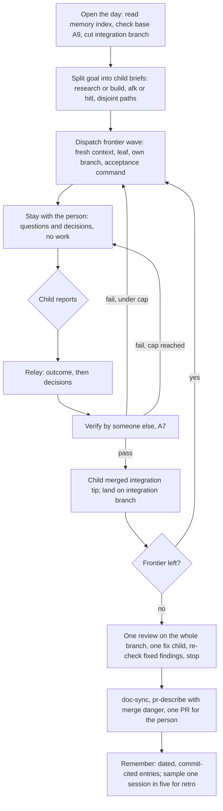

# Sources delta: what Matt Pocock teaches that this kit has not adopted yet

**Date:** 2026-11-24. **Round:** "Marjana" overhaul, research child session. **Baseline:** [the 2026-11 overhaul plan](2026-11-overhaul-plan.md), which studied `mattpocock/skills` at `abeeaf9` and the NetworkChuck video, and the skills on `zen/marjana-2026-11-24` (merge `220282a`).

**Status:** report only. Nothing in the kit changes with this file. Each row is a candidate for the orchestrator to accept, reshape or drop.

This file records only the **delta**. Whatever the plan already adopted and shipped (grill, domain-language, retro, tdd, improve-architecture, the two-axis review, merge danger, the phase-boundary tree, fresh-context leaf agents, user invocation, the `zen` router) is not restated, except where a source adds something the shipped skill lacks.

## Sources, and what could not be reached

| Source | State | What was read |
|---|---|---|
| `github.com/mattpocock/skills` | Reached. Cloned at `d653911` into a scratch directory outside this repository; nothing of it is committed. | `git diff abeeaf9..d653911` (five commits, all `chief-of-staff`), then every skill the plan's side-by-side table did not weigh: `chief-of-staff`, `implement-spec`, `implement`, `setup-matt-pocock-skills` and its templates, `wizard`, `triage` with `AGENT-BRIEF.md` and `OUT-OF-SCOPE.md`, `wayfinder`, `software-factory` with `EXAMPLE-TASKS.md`, `research`, `prototype`, `to-questionnaire`, `teach`, `handoff`, `claude-handoff`, `loop-me`, `wait-what`, `git-guardrails-claude-code`. |
| `aihero.dev/skills` and the pages it links | Reached, fetched with `curl` as markdown (`<page>.md`) or HTML, on 2026-11-24. | The catalogue; every `skills-*` page (setup, implement-spec, code-review, retro, handoff, wayfinder, triage and the rest); the six changelogs; the dictionary entries for AFK, human-in-the-loop, sandbox, subagent, context pointer, contextual knowledge, memory system, software factory, dark factory, automated review and human review; the methodology posts "The Home Repo pattern", "Watch me ship a 21,000-line feature", "A complete guide to AGENTS.md", "Never run Claude /init", "How to kill the bloat in Claude Code's system prompt", "Essential feedback loops", "11 tips for Ralph", "Why the Anthropic Ralph plugin sucks", the two hooks posts, the triage post and the Ronacher and Zechner interview. |
| aihero section index pages | **Unreachable.** `getting-started~svvtb`, `the-main-flow-jnjkc`, `shaping-we1mv`, `upkeep~6heor`, `productivity-skills~3cn9f` and `reference-skills-fshcd` return 404 as markdown and as HTML, although `skills.md` links them. | Nothing. Their content is not reconstructed here. |
| "Getting started with Ralph" | Fetched, then lost from scratch before it was read. | Not read. The "11 tips" post covers the same loop. |
| YouTube `mU8WKII1gpk` | **Unreachable from this environment.** `yt-dlp` stopped at YouTube's "sign in to confirm you're not a bot" check, and `youtube-transcript-api` failed the same way. Bypassing the check was not attempted. | Nothing. **No row in this report cites a video timestamp**, and the quotes section draws on Matt's written pages instead. The plan's video-derived conclusions stand as the plan recorded them. |

Every fetched page was treated as data under `A10` in [`autonomy.md`](../../.agents/rules/autonomy.md): nothing in them was run, installed or followed.

One discrepancy worth knowing: "How to kill the bloat" says `/setup-matt-pocock-skills` applies the bloat-removal settings in one run. The skill at `d653911` configures only the tracker, labels and domain docs, and its own docs page says the same. Treat the bloat-removal claim as unshipped.

## The short version

1. **The missing piece is the orchestrator itself.** Matt's newest work (`chief-of-staff`, `implement-spec`) is exactly the maintainer's working pattern: one session that delegates everything, stays in conversation with the person, merges children into one integration branch, and remembers. The kit has the parts (`fix-batch`, `verifier-agent`, `reconcile-worktrees`, `agent-handoff`, `pr-describe`) but no skill that runs the day. **Recommend a new draft, user-invoked `orchestrate` skill**, sketched below.
2. **`fix-batch` refuses dependent items; Matt's builder runs a task graph.** The frontier (tasks whose blockers have landed on the integration branch) is the idea to take, computed from merges rather than from tracker state.
3. **A per-repository setup step is the cheapest structural win.** Skills speak in roles ("the tracker", "the glossary", "the standards file"); one committed file per repository says what each role is there. Today each of our skills rediscovers it on every run.
4. **Name AFK and human-in-the-loop work explicitly.** Our autonomy rules know "nobody is watching" but no task, brief or router says which mode a piece of work should run in, or that ambiguous and one-way-door work stays in the loop.
5. **End every build with one review, one fix, then stop.** His docs record a four-hour review-and-fix loop and say the review "never" converges. Nothing in our chain says when to stop reviewing.
6. **Make memory dated and commit-cited.** "Write history, not the present" is a cheap rule that fits our provenance habits and solves the staleness that kills memory files.
7. **The learning loop needs three small additions**: sample sessions for retro instead of waiting for a bad one, ratchet a new check with an exception list, and prune checks that fire on good code.
8. **This repository's own `AGENTS.md` (205 lines) fails his central test**: only what is undiscoverable and globally relevant belongs in an always-loaded file.

## Delta table

Verdicts: **Adopt** (take the idea as is, in our words), **Adapt** (take it with a change), **Already have** (the kit covers it; cited so the claim can be checked), **Decline** (reasons in the declined section). Door: whether the change, once shipped to adopters, can be walked back cheaply.

### Orchestration and delegation

| Insight | Source | Our current state | Verdict | Target | Effort | Door |
|---|---|---|---|---|---|---|
| The orchestrator **delegates the work and keeps the conversation**: subagents do the work; questions, interviews and check-ins with the person stay in the main session, whose context stays free for the person and for memory. | `skills/in-progress/chief-of-staff/SKILL.md:7-11` at `d653911`; changeset `chief-of-staff-soften.md` | No standing orchestrator. `fix-batch` is one batch, started by a person, and ends without landing (`.agents/skills/fix-batch/SKILL.md:208-212`). | Adopt | new `orchestrate` (draft, `invocation: user`) | M | two-way |
| **Relay format**: lead with the outcome and anything the person must decide; add detail only when it changes what they would do. | `chief-of-staff/SKILL.md:15` | `fix-batch` reports a nine-field machine record (`fix-batch/SKILL.md:208` onward); no rule for what reaches the person. | Adopt | `orchestrate` | S | two-way |
| Brief children with **context pointers**, not retyped content: goal, what is ruled out, scope, then paths and commits. | `chief-of-staff/SKILL.md:13`; `implement-spec/SKILL.md:17` | "Durable repository files over pasted" content is already a brief rule (`.agents/skills/agent-handoff/SKILL.md:78`). | Already have | `agent-handoff` | n/a | n/a |
| **Delegate and remember**: a wiki of interlinked pages with `index.md`, one page per decision, problem or preference; ingest on every durable lesson, query before each decision and brief, lint by delegation. Look for a shared wiki first. | `chief-of-staff/SKILL.md:26-38` | Nothing. No skill keeps cross-session memory; `grep -i wiki` over `.agents/` finds no hit. | Adapt: keep it in the target repository's own convention (or the maintainer's home repository), and lint it with a script where the shape is decidable | `orchestrate` plus a `references/memory.md` | M | two-way |
| **Write history, not the present**: date every claim, cite the commit a code claim was true at, never write a bare "currently"; supersede, never rewrite. | `chief-of-staff/SKILL.md:40-47` | Close in spirit (dated `CHANGELOG.md` lines, provenance `retrieved` dates), but `writing-for-agents.md:81` only warns that a document is a stale cache; it gives no rule for keeping one honest. | Adopt | `orchestrate` memory rules; one line in `writing-for-agents.md` | S | two-way |
| **After friction, offer**: when a task hit a workaround, retry or blocked step, ask what would have made it easier and offer the environment change; never apply it unasked. | `chief-of-staff/SKILL.md:49-55` (replaced the older "relentlessly improve" in `742afa6`) | `retro` proposes and applies only what is approved (`.agents/skills/retro/SKILL.md:114`), but only when a person starts it. | Adapt: the orchestrator raises the offer and routes it to `retro` | `orchestrate`, `retro` | S | two-way |
| **Sample sessions for retro**: about one subagent session in five, failures first. | `chief-of-staff/SKILL.md:23`; v1.3 changelog ("run it on a sample of sessions") | `retro` reads one session, one pull request, or the last few pull requests (`retro/SKILL.md:31-39`). | Adopt: add a sampled-sessions input | `retro` | S | two-way |
| Tickets are a **task graph with a frontier**; start every frontier ticket at once and dispatch more as blockers land. | `implement-spec/SKILL.md:13`, `:36` | `fix-batch` excludes items that depend on each other (`fix-batch/SKILL.md:30-32`); `new-task` already records `depends_on` (`.agents/skills/new-task/SKILL.md:36`). | Adapt: `orchestrate` dispatches in frontier waves and reuses `fix-batch`'s prompt contract per wave | `orchestrate` | M | two-way |
| Compute the frontier **from what has merged into the integration branch**, not from tracker state: tracker blockers close only when the final PR merges. | aihero `/skills-implement-spec`, "Blocked tickets never start" | No frontier exists to compute. | Adopt | `orchestrate` | S | two-way |
| **One integration branch**; each child confirms its base, merges the integration tip into its own branch before reporting, so landing is a fast-forward; a separate merger lands it. | `implement-spec/SKILL.md:27-34`; aihero `/skills-implement-spec` | `reconcile-worktrees` lands verified worktrees one at a time into the main checkout and merges the target back before a PR (`.agents/skills/reconcile-worktrees/SKILL.md:5`, `:45-50`). The `A9` base check exists (`.agents/rules/core.md:29-31`). | Adapt: the integration branch is the landing branch; the child merges its tip before reporting | `orchestrate`, `reconcile-worktrees` | S | two-way |
| An **exploration child** writes shared notes outside the repository, so implementers implement instead of exploring, and the notes fix shared names before parallel work collides. | `implement-spec/SKILL.md:25`; aihero FAQ on `blockedSince` versus `blockedOn` | Disjoint `touched_files` prevent most collisions (`fix-batch/SKILL.md:37-46`), but nothing fixes shared names across children. | Adapt | `orchestrate` | S | two-way |
| **Review once at the end, fix once, then stop.** A mid-run review reads every unbuilt ticket as a failure; repeated broad reviews never converge. Re-check only the fixed findings. | `implement-spec/SKILL.md:38`; aihero `/skills-implement-spec` (four-hour loop) and `/skills-code-review` ("never will") | `verifier-agent` runs per item (`fix-batch/SKILL.md:181`); `house-review` has no stopping rule (`.agents/skills/house-review/SKILL.md:30-33`). | Adopt | `orchestrate`, `house-review` notes | S | two-way |
| A **deterministic loop beats an agent loop** for true AFK work; the agent loop is the on-ramp until the loop is tuned. | v1.3 changelog, "three ways to work through a set of tickets"; aihero `/skills-implement-spec`, "Sandcastle" | Nothing says when a script should replace an orchestrating agent. | Adopt as guidance; Decline building a loop runner now | `orchestrate` notes, `zen` | S | two-way |
| **Cap every loop** at a few tries before a human. | `skills/in-progress/software-factory/SKILL.md:62`; "11 tips" tip 2 | A bound exists for debugging only (`.agents/skills/systematic-debugging/SKILL.md:51`). | Adopt | `orchestrate` (rework cap) | S | two-way |
| **Merging children's work is not merging your own.** His orchestrator merges every implementer into the integration branch; the human reviews only the final result. | `implement-spec/SKILL.md:34`, `:40` | `A8` says "never merge your own work" (`.agents/rules/autonomy.md:139-142`); the plan approved orchestrator merges into the integration branch (decision 4) but no rule text says so. | Adapt: state the exception in `autonomy.md`: an orchestrator may merge into an integration branch only work it did not author and that someone else verified (`A7`); only a person merges into `developer` or `main` | `autonomy.md`, `core.md` | S | one-way (it widens the unattended ceiling) |
| **Split a huge integration branch into stacked diffs**: a run of two-way doors ending in the one-way door, behind a flag where possible. Human review is mandatory only on the one-way door. | aihero "Watch me ship a 21,000-line feature", section "Stacked diffs" | `pr-describe` states one door per pull request (`.agents/skills/pr-describe/SKILL.md:108-118`); nothing offers a split. | Adapt: `pr-describe` offers a stack when the diff is large and holds a one-way door | `pr-describe` | M | two-way |

### Human in the loop, AFK, and where the human stays

| Insight | Source | Our current state | Verdict | Target | Effort | Door |
|---|---|---|---|---|---|---|
| **AFK versus human-in-the-loop** as a named choice per piece of work. AFK suits well-specified, low-risk, easy-to-verify work; ambiguous, irreversible or hard-to-review work stays in the loop. Give input before (grill, spec) and after (a reviewable PR), not during. | aihero dictionary `afk`, `human-in-the-loop`; "11 tips" tip 2 | `core.md:9-10` scopes `A1` to `A9` to "nobody is watching", but no task, brief or router says which mode work should run in. `grep -i afk` over `.agents/` finds nothing. | Adopt: a `mode: afk | hitl` field in task files, set by the door and blast radius | `new-task`, `zen`, `orchestrate` | S | two-way |
| **Decision work has types**: research (AFK, by a subagent), prototype and grilling (human in the loop), task (does rather than decides). A human-in-the-loop item resolves only through a live exchange; an agent answering its own questions has broken it. | `wayfinder/SKILL.md:73-80` | `grill` already looks facts up instead of asking and puts decisions to the person (grill description). No other decision type exists. | Adapt: the research and prototype types become children the orchestrator can dispatch | `orchestrate`, `grill` | S | two-way |
| **Fog and out-of-scope** as two separate sections: fog is in scope but not yet sharp enough to ticket; out of scope never graduates. | `wayfinder/SKILL.md:82-101` | `grill`'s decisions record has **Still open** (deferred decisions with an owner) but no out-of-scope section (`.agents/skills/grill/SKILL.md:112-131`). | Adapt: split **Still open** into deferred decisions and fog, and add **Out of scope** | `grill` | S | two-way |
| A **research** skill: a fresh background agent investigates against primary sources and writes one cited markdown file where the repository keeps such notes. | `skills/engineering/research/SKILL.md` | No research skill. This report is a hand-briefed instance of it. | Adopt as a draft, bound by `A10` | new `research` (draft) | S | two-way |
| A **prototype** skill: throwaway code that answers one question (logic as a single HTML file; UI as switchable variants), captured on a branch with the verdict recorded. Build several, because the one you dislike teaches most. | `skills/engineering/prototype/SKILL.md`; aihero 21,000-line post, "Prototypes" | None. | Adapt: draft only, promoted after the maintainer uses it (contribution bar, `AGENTS.md` section 7) | new `prototype` (draft) | M | two-way |
| **Grill the send, not the subject**: when the person cannot answer, interview them only about who to ask and what they need back, then write a questionnaire aimed at the gap. | `skills/productivity/to-questionnaire/SKILL.md` | `human-handoff` writes to a person but never extracts knowledge from one. | Adapt as a mode | `human-handoff` | S | two-way |
| **Human-only steps become a script, not chat instructions**: open each URL, say what to click, take secrets by hidden entry so no secret reaches the agent, confirm before irreversible steps. | `skills/engineering/wizard/SKILL.md`; v1.2 changelog | `<spec>.runbook.md` is a prose file kind for steps no agent can perform (`AGENTS.md:35`). | Adapt: a runbook may ship as a stdlib Python script, never bash (cross-platform rule, `AGENTS.md` section 6) | `doc-author` or the runbook convention | M | two-way |
| **Prompt with the why**: the person dictates the problem and the reason; a "what" gets an uncreative answer. The person drives the grilling and may narrow it to one question at a time. | aihero 21,000-line post, "Grilling: prompt with the why" | `grill` attaches a why to each of its own questions (`.agents/skills/grill/SKILL.md:63`); nothing asks the person to open with theirs. | Adapt: the opening move asks for the problem and its why | `grill` | S | two-way |
| **The glossary is the data model**; test candidate names against real sentences in a table before settling one. | aihero 21,000-line post, "The glossary is the data model" | `domain-language` challenges a term against the glossary (`.agents/skills/domain-language/SKILL.md:49`), with no scenario test. | Adopt | `domain-language` | S | two-way |
| **Human review is review of the system**: read for patterns that hurt the agent's environment, and turn each into a check. | aihero 21,000-line post, "Human review" | `retro` reads every review comment as a candidate (`retro/SKILL.md:59-62`). | Already have | `retro` | n/a | n/a |

### Context hygiene

| Insight | Source | Our current state | Verdict | Target | Effort | Door |
|---|---|---|---|---|---|---|
| **Keep the always-loaded file nearly empty**: only what is undiscoverable and globally relevant. Never generate it with `/init`; structure listings and file paths go stale and mislead. | aihero "Never run Claude /init"; "A complete guide to AGENTS.md" | The lens already says a restated listing is a stale cache (`.agents/rules/writing-for-agents.md:81-87`), but this repository's `AGENTS.md` is 205 lines, with a layout table, a script enumeration and the provenance field table. `init-worktracking` seeds detected commands into `AGENTS.md` (`.agents/skills/init-worktracking/SKILL.md:75`), which are discoverable from the manifest. | Adapt: prune this repository's `AGENTS.md` to pointers, and seed adopters' files with less | `AGENTS.md`, `init-worktracking` template | M | two-way |
| **Measure, then trim the hidden payload**: `/context`, a logging proxy, `disable*` flags and bare-name `permissions.deny` rules remove tool definitions from every request. | aihero "How to kill the bloat in Claude Code's system prompt" | The validator guards description length and the lens names a context budget (`writing-for-agents.md:27-31`); tool payload is never measured. | Adapt: an optional, labelled Claude Code section in `docs/INSTALL.md`; no preset, because orchestration needs the task and worktree tools | `docs/INSTALL.md` | S | two-way |
| **Compact right after the conversation becomes a document**: it is nearly free then, and the run starts back at a small context. Dumb-zone cost is money as much as quality. | aihero 21,000-line post, "Compact, then run it AFK" | The phase-boundary tree exists (`agent-handoff/SKILL.md:31-45`), without this cue. | Adapt: one cue in the compact branch | `agent-handoff` | S | two-way |
| A handoff written in the temporary directory can vanish between sessions; a belief written as a fact becomes a false premise. | aihero `/skills-handoff` | Claims are checked against the tree before the brief is written (`agent-handoff/SKILL.md:62`); files go to the temporary directory (`:94-98`) with no durability warning. | Adapt: one sentence on durability | `agent-handoff` | S | two-way |
| **Composition must load, not merely mention**: "call the Skill tool with X", because a skill named in prose is not reliably loaded. | v1.3 changelog, "skills call the Skill tool" | A relative link guarantees the sibling is installed (`AGENTS.md:121`), not that the agent opens it. | Adapt: write each composition point as an imperative ("read and follow `../x/SKILL.md` now"), harness-neutral | every composing skill; `writing-for-agents.md` | S | two-way |
| **Codex sidecar**: `agents/openai.yaml` with `allow_implicit_invocation: false` is Codex's equivalent of `disable-model-invocation`. | v1.2 changelog, "Codex metadata on every skill" | `install.py` renders the Claude Code key only (`scripts/install.py:37`); `build-adapters.py` emits Cursor, VS Code and plugin targets, no Codex. | Adopt for `invocation: user` skills, after checking Codex's current format | `install.py`, `build-adapters.py` | S | two-way |

### Feedback loops and determinism

| Insight | Source | Our current state | Verdict | Target | Effort | Door |
|---|---|---|---|---|---|---|
| **Ratchet** a stricter check: switch it on, list today's failing files as exceptions, fix one per run until the list is empty. | `software-factory/EXAMPLE-TASKS.md`, "Ratchet task"; aihero 21,000-line post | `retro` proposes the cheapest new check (`retro/SKILL.md:68-91`) but has no path for a check that cannot pass on day one. No `ratchet` hit anywhere. | Adopt | `retro` | S | two-way |
| **Prune checks as well as prose**: a rule that fires constantly on good code is the sign to remove it; a one-session retro cannot see that. | aihero `/skills-retro`, "Won't this pile up lint rules forever?" | `retro` deletes no-op prose but never audits the checks it proposed earlier. | Adopt: a periodic "checks audit" input to `retro` | `retro` | S | two-way |
| **Comments as fig leaves**: a comment beside a workaround licenses it; audit comment density against the repository average. | aihero 21,000-line post, "Retro" | No such audit. | Adapt: a standards-axis smell, not a check | `house-review` rubric or `retro` | S | two-way |
| **Turn prose rules into deterministic hooks** (a `PreToolUse` gate that exits 2 with a message the agent reads). | aihero "How to use Claude Code hooks to enforce the right CLI" | `retro`'s "misplaced instruction" category moves instructions into checks (`retro/SKILL.md:68-91`); hooks follow a reminder-or-gate contract (`.agents/hooks/README.md:7`). | Already have | `retro` | n/a | n/a |
| A **guardrail gate for destructive git** (`reset --hard`, `clean -f`, `branch -D`, `checkout .`). | `skills/misc/git-guardrails-claude-code/SKILL.md` | Prose only: "Never `git reset --hard`" (`fix-batch/SKILL.md:107`); `A8` points at a `permissions.deny` rule (`autonomy.md:142`). | Adapt: an opt-in gate in `.agents/hooks/`, decidable from the payload; not `git push`, which our flow needs | `.agents/hooks/` | M | two-way |
| **Pre-commit runs the checks**; an agent never tires of a failing hook. | aihero "Essential AI coding feedback loops"; `skills/misc/setup-pre-commit` | `project-bootstrap` writes linter config but deliberately runs no installs (`.agents/skills/project-bootstrap/SKILL.md:34`); `retro` reports absent guardrails (`retro/SKILL.md:101`). | Adapt: `project-bootstrap` offers a pre-commit config that runs the acceptance command, printed not installed | `project-bootstrap` | S | two-way |
| **State the quality bar** (prototype, production, library), because the repository wins over instructions; take risky work first. | "11 tips", tips 7 and 8 | `new-task` records risks (`new-task/SKILL.md:40`) but does not order risky slices first; no quality-bar line is seeded. | Adapt | `new-task`, `init-worktracking` | S | two-way |
| **Cross-family adversarial review** as insurance, filtered by the person because reviewers get overzealous. | aihero, Ronacher and Zechner interview, "Is verification overrated?" | `A7` separates author and verifier (`core.md:27-28`), with no model diversity. | Adapt: an optional "different model family, where the harness allows" line | `house-review`, `verifier-agent` | S | two-way |
| Trust signal: **reproduced, a failing test, and a fix that makes it pass**. | aihero, Ronacher and Zechner interview, "Trust" | The verdict-with-evidence contract (`A4`, `verifier-agent`). | Already have | n/a | n/a | n/a |
| A worktree carries only tracked files, so tests on gitignored fixtures **skip silently and report green**. | aihero `/skills-implement-spec` FAQ | Handled before dispatch (`fix-batch/SKILL.md:48-67`). | Already have | n/a | n/a | n/a |

### Setup, distribution and security

| Insight | Source | Our current state | Verdict | Target | Effort | Door |
|---|---|---|---|---|---|---|
| **Install-time setup per repository**: skills speak in roles; one committed file per repository maps each role to that repository (tracker, labels, glossary, ADRs). Explore, recommend, confirm one section at a time, then write. | `skills/engineering/setup-matt-pocock-skills/SKILL.md`; aihero `/skills-setup-matt-pocock-skills` | Each skill rediscovers on every run: `domain-language` searches for the glossary (`domain-language/SKILL.md:35-42`); `init-worktracking` detects trackers but records only a prose boundary in `AGENTS.md` (`init-worktracking/SKILL.md:59-62`, `:128`). | Adopt, as designed in the next section | `init-worktracking`, `zen`, `install.py` (one printed line) | M | one-way once adopters depend on the file format |
| **A blocked state** is the most-filed gap in his triage labels: "ready" is misleading for work that waits on another item. | aihero triage post, "Five states aren't enough" | `depends_on` already blocks a task until its dependencies reach `done/` (`new-task/SKILL.md:36`). | Already have for `.tasks/`; carry it into the role map for external trackers | setup design | S | two-way |
| **The home repository**: one repository for skills, shared docs and one-line pointers to every other repository; sessions start there. | aihero "The Home Repo pattern" | `install.py` places skills at user scope; `agent-observatory` (draft) reads across repositories. | Adapt: a documented pattern for the orchestrator's memory and pointers, not a feature | `docs/GETTING-STARTED.md` | S | two-way |
| **Security when installing other people's skills.** | No reachable source covers it: the aihero pages and the skills reached say nothing on vetting a third-party skill, and the video could not be read. | `A10`, provenance with upstream digests, and `check-provenance.py` cover adapted material, not installed third-party skills. | Not assessed from these sources; listed so the gap is visible | n/a | n/a | n/a |

## Install-time setup walkthrough

### How his works

1. **Explore, read-only.** `git remote -v` for the host; whether `CLAUDE.md` or `AGENTS.md` exists and already carries an `## Agent skills` block; `GLOSSARY.md` or `GLOSSARY-MAP.md` (offering a `git mv` from the legacy `CONTEXT.md`); `docs/adr/`; earlier output in `docs/agents/`; a `.scratch/` directory as a sign of the local-markdown tracker; whether `triage` is installed; monorepo signals (`setup-matt-pocock-skills/SKILL.md:19-30`).
2. **Present and ask, one section at a time**, each led by the recommended answer so a single word accepts it, skipping any section exploration already settled (`:32-36`). Issue tracker (GitHub, GitLab, local markdown under `.scratch/`, or "other" described in one paragraph); triage labels, asked only when `triage` is installed, as one yes-or-no question; domain-doc layout, single-context by default, multi-context offered only on monorepo signals (`:38-63`).
3. **Confirm**: show the `## Agent skills` block and the three files as drafts, and let the person edit them (`:65-72`).
4. **Write**: edit whichever of `CLAUDE.md` or `AGENTS.md` exists, never create the other, update an existing block in place; write `docs/agents/issue-tracker.md`, `domain.md` and, when `triage` is installed, `triage-labels.md` from seed templates (`:74-116`).
5. **Done**: name the skills that now read these files; day-to-day edits are made by hand (`:118-120`).

**Why it works.** The skills never change between repositories. A skill says "publish to the issue tracker" or "apply the AFK-ready role", and the per-repository file translates the role into commands (`issue-tracker-github.md`, "When a skill says publish to the issue tracker"). An unsupported tracker is one paragraph of prose. The tracker file also carries skill-specific operations, such as wayfinder's map and frontier queries (`issue-tracker-local.md`, "Wayfinding operations").

**What his docs admit is broken** (aihero `/skills-setup-matt-pocock-skills` and the triage post): it picks the instruction file by which exists, not by which harness runs, so a leftover `CLAUDE.md` hides the block from Codex; it never creates the labels it maps, so the first `gh issue edit --add-label` fails; seed templates change between versions, leaving older repositories silently out of date; there is no user-level mode; and some users object that the model configures its own skills.

### Recommended design for this kit

**One file, committed, owned by the repository: `docs/agents/zen.md`.** Prose for people, plus one fenced block tagged `zen-config` of `key: value` lines that the Python standard library can parse, the same placement idea as our provenance blocks. Keys, each optional:

| Key | Holds | Read by |
|---|---|---|
| `config_version` | The layout version, so a reader can say "this file predates key X" instead of failing silently | every reader |
| `tracker` | `tasks` (this kit's `.tasks/`), `github`, `gitlab`, or `other`; for `other`, a prose section below the block says how to create, read, label and close | `new-task`, `fix-batch`, `orchestrate`, `pr-describe` |
| `roles` | The label for each role: `ready-agent`, `ready-human`, `needs-info`, `blocked`, `out-of-scope` | `new-task`, `orchestrate` |
| `glossary`, `adr_dir` | Paths, or `none` | `domain-language`, `grill`, `house-review` |
| `spec_dir` | Where specs live | `spec-author`, `house-review`, `verifier-agent` |
| `standards` | The files the standards axis reads | `house-review`, `retro` |
| `acceptance` | The one command that decides acceptability | `verifier-agent`, `fix-batch`, `orchestrate` |
| `base_branch`, `integration_prefix` | Where work lands, and how integration branches are named | `reconcile-worktrees`, `orchestrate`, `pr-describe` |
| `merge_policy` | Who merges what (for example: orchestrator into integration branches, a person into `base_branch`) | `orchestrate`, `autonomy.md` readers |
| `session_logs`, `memory` | Where retro finds sessions, and where the orchestrator keeps its dated log | `retro`, `orchestrate` |
| `default_mode` | `hitl` or `afk` for a task that does not declare one | `new-task`, `orchestrate` |

**Who writes it: `init-worktracking`, with a new "configure the skills" step**, because it already explores the repository, detects trackers, and writes into the target in that repository's conventions (`init-worktracking/SKILL.md:59-62`). Copy his interaction shape exactly: explore read-only, recommend, one section per answer, skip what exploration settled, show the draft, write only on confirmation. It also adds an `## Agent skills` pointer block to `AGENTS.md`, which is canonical here; `CLAUDE.md` already imports it, which closes his Codex gap by construction. Re-running it updates the file in place and never rewrites a value the person edited by hand.

**Who points at it: `zen` and `install.py`, neither of which writes it.** `install.py` stays user-scope and never edits a repository; after an install it prints one line: "In each repository, run `init-worktracking` once to configure the skills." `zen` hints at that step when a repository has no `docs/agents/zen.md`, and never starts it (`.agents/skills/zen/SKILL.md:6`).

**How the skills read it.** Read the block if present; an absent file or key falls back to today's discovery, and the skill says once which it used. A missing file never blocks a run.

**Determinism over prose.** The `validate.py` that `init-worktracking` installs parses the block and fails on an unknown key or a path that does not exist. Labels the configuration names but the tracker lacks are printed as `gh label create` commands, never run, following `pr-describe`'s print-don't-run habit. `config_version` turns his stale-template problem into a named message.

**Kept out of it, as in his design:** behaviour preferences (grilling cadence, tone). The file records facts about the repository, not how the skills should behave.

**Harness-agnostic by construction:** plain markdown, one parseable block, no harness setting. The Claude Code payload trimming goes in an optional labelled section of `docs/INSTALL.md`, not in this file.

**Decision for the maintainer:** the path and the block format. Once adopters configure their repositories against them, changing either is a migration, so this is the one-way door in the design.

## Orchestrator pattern

### How his two orchestrators work now

**`chief-of-staff`** (in progress, `d653911`) is the role. It delegates the work to fresh background subagents, briefed with context pointers plus goal, exclusions and scope; keeps the conversation with the person in its own session; relays each result as outcome first, decisions second; offers a recurring job when a task plainly recurs; and keeps a dated, commit-cited wiki with ingest, query and lint. It runs `retro` on about one session in five and runs large work as `to-spec`, `to-tickets`, `implement-spec`. After friction, it offers environment changes rather than making them. The five commits since `abeeaf9` moved it from "pursue a long-running goal" to exactly these two jobs, and from imposing improvements to offering them.

**`implement-spec`** is the build procedure. It reads the spec and tickets as a task graph; optionally runs an exploration subagent that writes shared notes outside the repository; creates one integration branch; starts a fresh implementer per frontier ticket, each in its own worktree, using `tdd`, merging the integration tip before reporting; lands each through a merger subagent; dispatches the new frontier; runs one `code-review` over the whole branch and one fixer; marks the draft PR ready or resolves tickets; cleans up worktrees. His own docs call it worse than a deterministic loop, but the right start before one is tuned.

### How that maps onto the maintainer's day

| The maintainer's practice | His equivalent | What this kit has | Gap |
|---|---|---|---|
| One orchestrating cloud session per project or day | `chief-of-staff` | Nothing that holds the role | the skill itself |
| Child cloud sessions for research and implementation | background subagents with fresh contexts | `fix-batch`'s dispatch contract; `agent-handoff`'s brief | children as separate sessions, frontier waves |
| Each child on its own branch | implementer worktrees | `fix-batch` cuts `agent/<id>` worktrees at a recorded sha | children push a named branch instead of a local worktree |
| All merged into one integration branch | integration branch plus merger subagent | `reconcile-worktrees` lands into the main checkout | integration-branch landing and the `A8` exception |
| One pull request for the human | draft PR marked ready at the end | `pr-describe` with merge danger | one-review-then-stop; optional stacked split |
| Continuity across days | the wiki | none | dated, commit-cited memory |

### Recommendation: a new draft skill, `orchestrate`, not an extension

- **Not `fix-batch`.** Its contract is one batch of independent items that ends in a report and merges nothing (`fix-batch/SKILL.md:30-32`, `:208-212`). A day-long, dependency-aware loop with a conversation and memory would break both halves of that contract. `orchestrate` reuses `fix-batch`'s prompt contract for each wave instead.
- **Not `agent-handoff`.** It writes briefs and decides phase boundaries; `orchestrate` composes it for every child brief.
- **Not `zen`.** It only hints and never starts a skill (`zen/SKILL.md:6`).

Shape: `metadata.status: draft`, `invocation: user`, `license: MIT`; it composes `agent-handoff`, `verifier-agent`, `reconcile-worktrees`, `pr-describe` and `retro` by link, since a draft may link shipped skills. "Child" stays transport-neutral: an in-session subagent, a worktree agent, or a separate cloud session, whichever the harness offers. A Claude Code cloud section (`create_session`, `send_message`) goes under a labelled optional heading, per the portability contract.

Procedure sketch, each step with a done-when in the final skill:

1. **Open.** Read the memory index and the `zen-config` block; check the base (`A9`); cut the integration branch from the target tip; commit the day's plan to it.
2. **Brief.** One brief per child, through `agent-handoff`: goal, what is ruled out, owned paths, context pointers, mode (`afk` or `hitl`), branch name, acceptance command, report fields, "you are a leaf", "merge the integration tip before you report". A `hitl` item stays in the orchestrator's own conversation and is never delegated.
3. **Dispatch the frontier.** Every child whose `depends_on` items have landed on the integration branch, computed from merges and not from tracker state.
4. **Hold the conversation.** While children run, the orchestrator answers and asks the person, and does no implementation.
5. **On each report.** Relay outcome and decisions; verify with `verifier-agent` run by someone other than the child; on pass, land it on the integration branch (fast-forward where the child merged the tip); on fail, re-dispatch up to a cap, then bring it to the person.
6. **Close.** One `house-review` over the whole integration branch, one fix child, a focused re-check of the fixed findings, then stop. Run `doc-sync`; write the body with `pr-describe`, offering a stacked split when the branch holds a one-way door; open one draft pull request for the person. Never merge into `developer` or `main`.
7. **Remember and learn.** Append dated, commit-cited entries to the memory; offer environment changes where a child hit friction; queue a `retro` over about one child session in five, failures first.

**Rule text the skill needs before it can ship:** the `A8` exception for integration-branch merges, stated in `autonomy.md` and mirrored in `core.md`, which is the one-way door flagged in the delta table.

## Declined, with reasons

- **`triage` as a skill.** It is built for inbound issues from outside contributors, and his own docs say it is rarely used when everything comes from your own planning. This kit's tracker is `.tasks/`, filled by `new-task`. Two parts survive elsewhere: the role vocabulary goes into the setup design, and the "generated by AI" disclaimer is worth reusing if any skill ever posts to a public tracker.
- **Durable agent briefs without file paths.** His briefs sit for weeks, so paths go stale; ours are executed soon and validated, and `touched_files` is a contract `validate.py` checks. Different trade-off, same goal.
- **`wayfinder` now.** It is the right tool for an effort too big for one session, but it is large (L) and the contribution bar asks for real use first. Keep it on the roadmap until an effort needs it; its fog and out-of-scope sections are adopted into `grill` above.
- **`software-factory` as a glossary skill.** Premature for a solo maintainer. Its brakes (start slow, throttle, cap loops) and its five questions per task go into `orchestrate`'s notes for whenever a recurring job is offered.
- **Automating `retro` after every session.** His docs warn that an automated retro chases false positives; sampling (adopted above) is the middle ground.
- **A bash wizard template.** The idea is adopted; bash is not, because this kit targets Windows as well (`AGENTS.md` section 6).
- **`claude-handoff` (`claude --bg`).** Single-harness. At most a labelled optional line in `agent-handoff`.
- **`teach`, `loop-me`, `writing-beats` and the other writing skills.** Personal productivity, outside this kit's engineering scope (`docs/CATALOG.md` tiers).
- **A preset of `permissions.deny` rules to trim the payload.** Harness-specific, and the tools it removes (tasks, worktrees, workflows) are the ones orchestration uses. Measuring is documented instead.
- **Blocking `git push` in the guardrail hook.** Our flow pushes branches by design; `A8` and branch protection already cover merging.
- **"Skills take no per-user configuration."** Kept in spirit: the setup file records facts about a repository, not behaviour preferences.

## Quotes worth keeping

The video could not be fetched, so none of these carries a timestamp; each comes from Matt Pocock's written pages, with its source.

1. "If I give the agent the why, it feels a lot more empowered to produce a solution itself." (aihero, "Watch me ship a 21,000-line feature")
2. "By implementation, I'm trying to give the agent no decision space." (same page)
3. "I'm not just interested in what the code does. I'm interested in the system that produced it." (same page)
4. "The comment next to a workaround often acts as a fig leaf." (same page)
5. "A check can fail. A sentence in a Markdown file cannot." (aihero, v1.3 changelog)
6. "The agent loop is worse than a deterministic loop." (same changelog)
7. "Do not run it in a loop until it comes back clean, because it never will." (aihero, `/skills-code-review`)
8. "Every trigger is an accelerator. Accelerators without brakes make a slop cannon." (`software-factory/SKILL.md:56`)
9. "only include what is both undiscoverable and globally relevant." (aihero, "Never run Claude /init")
10. "Worktrees don't remove collisions; they postpone them to merge time." (aihero, `/skills-implement-spec`)
