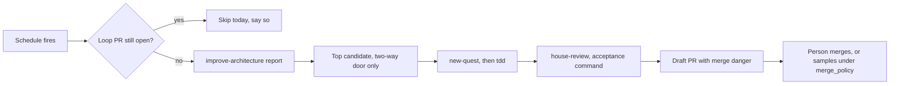

# Plan F1: a daily improvement loop

Status: **plan only, nothing built or scheduled.** Written 2026-11-25 for quest [`chore-0110`](../../.quests/chore-0110-plan-the-daily-improvement-loop.md), Phase 3 of the [round 2 plan](2026-11-25-marjana-r2-plan.md). Decision F1 in [the decision record](2026-11-25-marjana-decisions.md) says yes and leaves the repositories open. The [round 2 handoff](2026-11-25-round-2-handoff.md), section 3: "Do not schedule recurring jobs on any repository (F1) without the maintainer naming the repository."

## Goal

Once a day, in each repository the maintainer names, an agent runs `improve-architecture`, takes its single top suggestion, builds it, and opens **one draft pull request**. A person reviews a sample and merges. The code keeps getting easier for the next agent to change, without anyone remembering to ask.

The source is Matt Pocock on NetworkChuck's podcast ([extraction](2026-11-25-podcast-extraction.md), Stage 12): "a cron job that runs on each of my repos where once a day it will run improve codebase architecture and it will give me a top suggestion back and then it will go and make a pull request" (~1:02:12), reviewed by sampling "every five PRs or so" (~1:03:01), run as Claude Code inside scheduled GitHub Actions (~1:04:15). Section 5 items 12 and 13 of the extraction record both as new to the kit.

## What exists to build on

- [`improve-architecture`](../../.agents/skills/improve-architecture/SKILL.md) (shipped): finds hot spots and proposes deepening refactors as an offline HTML report. It "reports and proposes. It refactors nothing." The loop's missing piece is the bridge from one picked candidate to a built change.
- The bridge already exists as separate skills: `new-quest` writes the candidate as a quest, `tdd` builds it, `house-review` reviews it, `pr-describe` writes the body with its merge danger (door and blast radius).
- The `orchestrate` draft, Step 7 item 3: "Offer a recurring job ... Offer it and stop: never schedule it yourself, and never pick its repositories; the person names them." This plan is that offer, written down.
- Rule `A8` in [`autonomy.md`](../../.agents/rules/autonomy.md) and the `merge_policy` key of `docs/spec/zen-config.md` (S-044 to S-046): sampled self-merge of verified two-way doors is opt-in per repository, off by default, sampled by merge-commit sha divisible by N (default 5, cap 20).
- Open quest [`feat-0065`](../../.quests/feat-0065-a-scheduled-sensor-for-the-drift-checks-that-only-run-when-somebody-remembers.md): a scheduled sensor for this kit's drift checks. Same scheduling question, smaller payload; whichever lands first sets the runtime for both.
- `retro`, run "over the last five" loop pull requests, as Matt does (~1:03:19), turns repeated review comments into checks.

## The loop, as proposed

## Smallest first slice

1. **One run by hand, no schedule**, on the first repository named: a session runs the loop end to end and opens one draft pull request. The maintainer reviews it in full. Recorded as a dogfood record.
2. Only after that, **one scheduled job on that one repository**, draft pull requests only, a person merges. Run for two weeks.
3. Only after ten reviewed loop pull requests, and only if the maintainer opts in, `merge_policy: self-merge-sampled 1/5` on that repository.

Slice 1 needs a short reference (the loop's brief, its brakes, its report) beside `improve-architecture` or in `orchestrate/references/`; no new skill.

## Risks and one-way doors

- **Slop cannon** (Matt, ~1:46:22: "You need to be able to pull the software factory back"). Brakes: at most one open loop pull request per repository (skip the day otherwise); stop and report after two pull requests in a row closed unmerged; a person can turn it off with one setting.
- **A refactor that is really a one-way door**: a changed public interface, a persisted format, a migration. The loop takes only candidates `new-quest` would mark `mode: afk`; anything `hitl` goes in the report, unbuilt.
- **Credentials.** The GitHub Actions route needs a model API key stored as a repository secret: a one-way door for exposure, since a workflow anyone can trigger could leak it. A claude.ai scheduled task needs no key in the repository.
- **Cost.** A daily run burns tokens whether or not it finds anything, and CI minutes on each pull request (B10's note: "lets save CI minutes where we can").
- **Turning on self-merge** is the step that changes what an unattended agent may do; it stays a separate, later decision.

## Rough size

Medium: one reference file and one dogfood run (one quest), then one scheduled job (one quest, mostly configuration), then an optional `merge_policy` change. About three quests.

## Questions for the maintainer

1. **Which repository should the daily improvement loop run on first?** (a) Zen Agent Skills itself, recommended: it has a full acceptance command and the loop's own skills live here; (b) the Zen product app, which you plan to launch soon, so daily refactor pull requests would land during the launch; (c) both; (d) another repository you name.
2. **Where should the scheduled job run?** (a) A claude.ai scheduled task that starts a fresh cloud session in a saved environment, recommended: no API key is stored in the repository; (b) Claude Code inside a scheduled GitHub Actions workflow, as Matt does, which needs an API key as a repository secret and spends CI minutes; (c) a cron job on your own computer.
3. **Who merges the loop's pull requests?** (a) You, always, for the first two weeks; revisit after ten reviewed, recommended; (b) sampled self-merge (`merge_policy: self-merge-sampled 1/5`) from the start.
4. **How often should it run?** (a) Daily, skipping any day an earlier loop pull request is still open, recommended; (b) weekly; (c) daily, opening a new pull request even when one is open.
