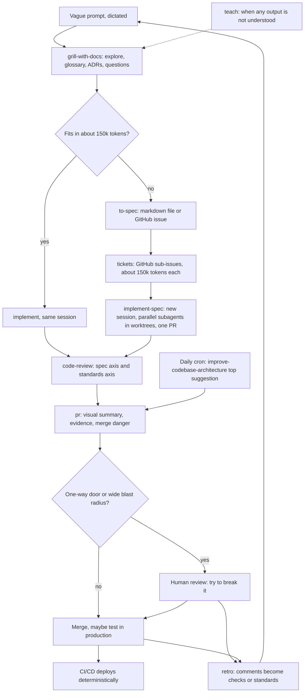

# Podcast extraction: "How to Actually Code with AI (ft. Matt Pocock)"

**Provenance of this file.** Written on 2026-11-25 by a research subagent of the Marjana orchestrating session from the video's auto-caption transcript, obtained through the Eden connector and read in full. The transcript itself is not committed; this file is notes, with quotes kept under 25 words. Times are estimates from the chapter markers. Committed per the maintainer's decision G6.

## About this extraction

- **Source:** NetworkChuck, YouTube `mU8WKII1gpk`, published 2026-11-20, 2:02:36 (7,356 s). Host: Chuck (NetworkChuck). Guest: Matt Pocock (Total TypeScript, AI Hero, `mattpocock/skills`).
- **Input:** the Eden `eden_read_social_post` result, field `post.transcript`, 131,768 characters, `transcriptStatus: available`, `transcriptTruncated: false`, `transcriptSource: cache` (YouTube auto-captions). **Read 100%**, in seven slices of about 20,000 characters.
- **Timestamps: the transcript carries none.** Every time below is an estimate, interpolated by character position between the 16 chapter markers in the video description, each pinned to an anchor phrase. Expect an error of roughly 30 seconds. Times are written `~mm:ss` or `~h:mm:ss`.
- **Speakers are not labelled.** Attribution to Matt or Chuck is inferred from content; where it matters, the line says who.
- **Mis-transcriptions** (auto-captions), used as corrected below:

| Transcript says | Means |
|---|---|
| Matt PCO | Matt Pocock |
| XATE / Xate | XState |
| Johnow, John Asterout | John Ousterhout (*A Philosophy of Software Design*) |
| Dex Hy | Dex Horthy (origin of "smart zone / dumb zone") |
| glossery | glossary |
| Momento | *Memento* (the film) |
| Whisper Flow | Wispr Flow (dictation app) |
| Opus 5.5 median | Opus 5.5 at medium effort |
| high XI, high x high | high, xhigh |
| codingstandards.mmd, agents.mmd | `coding-standards.md`, `AGENTS.md` |
| llinters | linters |
| a spare tickets | a spec or tickets |
| Versel, Netlefi, Superbase, planet scale, Postgress | Vercel, Netlify, Supabase, PlanetScale, Postgres |
| Gideia, Git T | Gitea (Chuck's self-hosted Git) |
| S castle | Sandcastle (Matt's open-source agent orchestrator) |
| Everlight, Everite | almost certainly Evalite (Matt's eval framework) |
| slot PR, slob cannon | slop PR, slop cannon |
| Carpathy style LLM wiki | Karpathy-style LLM wiki |
| Kemp Beck | Kent Beck |
| Lauren Tan "who goes by Potato, who works at Grockbot" | Lauren Tan ("Poteto"); the employer name is garbled, do not rely on it |
| 200x (subscription) | the top-tier Anthropic plan, read as the $200 "20x" Max plan; the transcript does not say which |
| "my own Hermes" | a personal assistant bot like the Hermes agent; the transcript gives no more |

**Chapters** (from the video description, exact): 0:00 Do you still need to learn a programming language? · 0:54 Who Matt Pocock is · 5:03 Tactical vs strategic programming, and why vibe coding wrecks code · 12:35 Live demo: Grill with Docs · 25:18 The smart zone and the dumb zone: write a spec first · 34:35 Sub agents in worktrees, and code review · 44:52 The trust ladder: tests, types and feedback loops · 52:31 The starter stack and deep modules · 1:01:01 Improve Code Base Architecture, live · 1:08:15 What you still need to learn · 1:14:11 Where to host your app, and deploying safely · 1:26:38 Open source in the age of slop PRs · 1:34:41 Advice for new developers: school, degrees, hiring · 1:44:39 Software factories and Matt's AI video editor · 1:56:49 Agents for your life · 2:01:01 A prayer for you.

Sponsor reads (ThreatLocker ~11:20, Coveron ~1:00:20, Bitdefender ~1:18:20) and the closing prayer carry no technical content and are skipped.

**Requested topics the transcript does NOT contain**, so nothing below invents them: Ralph (by name), hooks, MCP, `CLAUDE.md` practice (Matt never discusses an always-loaded file; only Chuck mentions `AGENTS.md`, and Matt replies about the standards file), plugins or marketplaces, `/init`, the terms "AFK" and "human-in-the-loop" (the ideas appear as trust, door type and software factory), TDD by name (tests and deep modules are discussed at length), PRDs, handoff, prototype, wayfinder, chief-of-staff, permissions. Sandboxes appear only through Sandcastle.

---

## 1. The loop, end to end

Matt's own one-sentence summary (~44:19): "the main flow where you grill with something, you either then [go] to spec and tickets, implement it, code review, and then retro so that it's better next time." He frames the skills as having "evolved into a process" that differs by task (~13:15), with "the strategic thinking ... blended into every stage of the process" (~13:29).

### Stage 0: the precondition is caring about the long view (~5:03 to ~11:16)

- **What:** before any skill, the human takes the strategic role. AI does tactical work; the human keeps "the house in order" (~8:03).
- **Why:** models are trained and benchmarked on single tasks, so "its focus is 100% tactical" (~6:06); strategic mistakes surface "9 months down the line" (~6:28), so they cannot be graded.
- **Skill:** none. "You just got to give a [damn]" is "the first place to start" (~11:16).

### Stage 1: a vague prompt, dictated (~14:46, ~16:04)

- **What:** he opens with a deliberately vague prompt. Live: "I need to improve the teleprompter part of my video editor. I think it's just gotten a little bit cluttered ... Can you help me out?" (~14:46).
- **How:** dictated with Wispr Flow. "I'm a huge dictation fan ... if you're not dictating, you're just going way too slow" (~16:11).
- **Why vague is fine:** the grilling step exists to close the gap, so the opening prompt need not be complete.

### Stage 2: grill with docs (~14:26 to ~24:40), demonstrated live

- **Skill:** `grill-with-docs`, which composes two skills: `grilling` (the interview) and `domain-modeling` (the glossary plus a line about architectural decision records) (~20:22). `grill-me`, his "most famous skill", is now "very short ... just call the skill tool with grilling" (~20:06).
- **What happened live, in order:**
  1. It explored the codebase with a subagent "looking in the background and sort of peeking at stuff" (~16:17).
  2. It read the glossary file: a "Language" section and a "Course structure" section defining course, sections, course versions, lessons ("single learning units within a section"), draft versions, pending versions (~15:00 to ~15:35). All "language that I've developed with the agent over time."
  3. It read the ADRs: `docs/adr`, "31 ADRs just knocking about in the repo" (~21:06).
  4. It asked questions: what does the teleprompter read from; when you film today, what's on screen; when do you use it; what's on screen at once while you read; what clutter have you noticed (~16:20 to ~16:55).
  5. **Observed flaw:** questions arrived before exploration finished. Matt: "it's probably better if I just wait for the explore to finish because it's kind of asking me stuff that it can figure out in the code" (~16:37).
  6. After exploration, the questions used his domain terms: "beats and scripts and animatics. Does the script still autoscroll? Is the status area at the top [dead] space?" (~19:21).
- **Why:**
  - The agent is "a developer that you're hiring" dropped in "like the guy from Memento ... totally blank slate" (~17:16 to ~17:22). People "underestimate that there's a communication gap" (~17:10).
  - Forcing questions gets "the result that you want instead of the result that you sort of hope for" (~17:56).
  - The gap "is not going to go away if the model gets smarter ... it's the human that's ... in the wrong" (~19:04).
  - He calls this stage "actually more tactical": it is about alignment before work (~16:55).
- **The glossary and ADRs:**
  - Every skill he has "says reference the glossary": use it for specs, and use it for modules, so code uses the same words as speech; database and front end align (~21:46 to ~22:10).
  - Counter-example: front end says "reversal", email says "pending chargeback", database says "refund" (~22:23).
  - The glossary made Opus 5 (which "was just garbage to talk to", that is, verbose) tolerable, because it spoke "the language of my application" (~15:46).
  - ADRs "document the stuff that you can't document in code"; code is "only the present"; without a record of the past "the agent will just continually make the same mistakes" (~20:35 to ~20:52). They record decisions "hard to reverse, expensive to take back" (~21:13).
  - **Bootstrapping:** no up-front setup. "Just start grilling and it will mint the terms and quiz you about the right terms as you go," focused on "the hot spots," then "it will say, 'would you like to update the code so that it matches the glossary?'" (~23:25). "Peeling like a little window of sanity in your vibe coded slop base" (~23:45). "The first strategic thing that I'd recommend folks do" (~24:07).
- **Newcomer instruction:** go to `aihero.dev/skills`, install, and "for your next feature, just use grill with docs" (~24:40 to ~24:57).

### Stage 3: choose the route by context size (~25:27 to ~27:14)

- **Small:** if the work "can fit inside the same context window as in the grilling," use the **`implement`** skill: "you turn the idea that you've just grilled about into code" (~25:39 to ~25:45).
- **Large:** if it "is going to be bigger than 150,000 tokens," write a spec (~27:20).
- **Why 150k, not 1M:** see the smart zone and dumb zone in section 3. "The actual number I think doesn't matter. It's more about the instinct of context paranoia" (~27:09).

### Stage 4: spec (~27:32, ~54:05)

- **What:** "take the conversation that you've just had in grill with docs and you turn it into a specification," living "either in a markdown file or ... in your GitHub repo as an issue" (~27:32).
- **Why:** the spec "defines where you're going"; "I can check the final product against this specification" (~27:40).
- **Detail:** "when you call to spec, it's going to ask you sort of what shape of modules you want, which might be a little too technical for some people, but just sort of keeps you in the code a little bit" (~54:11 to ~54:17).

### Stage 5: tickets (~27:45 to ~28:00, ~36:46 to ~37:11)

- **What:** "turn that spec into tickets ... the agent is going to walk through and actually implement one by one. So each ticket is going to be a session" (~27:58).
- **Sizing:** "each ticket should be around 150,000 tokens" (~36:53). Agents are "not amazing at it, but ... they do a good enough job" (~36:46).
- **Tracking:** "GitHub issues basically ... tracked as sub issues underneath each spec. And so, then you can just see the spec being completed" (~37:05 to ~37:11).
- **Naming:** he never says "to-tickets" aloud; he says "spec and tickets."

### Stage 6: implement-spec, subagents in worktrees (~34:42 to ~35:04)

- **Skill:** `implement-spec`. "You pass in the spec that you've just created in a new session and it goes and implements it all with parallel sub agents doing it in work trees, merging all back together until you get one mega PR ready for you to review" (~34:52 to ~35:04).
- Chuck's framing, "one orchestrator agent divvy[ing] that up between sub agents ... in work trees," gets "Yeah, exactly" (~34:42).
- **Token view:** some call sub-agents token-inefficient; he was "surprised by how well this works and by how token efficient it is" (~35:24 to ~35:50).

### Stage 7: code review, two axes (~28:05, ~37:29 to ~39:43)

- **Skill:** his `code-review`; "the implement spec actually calls code review" (~37:29). He calls it "a sort of adversarial review on the thing that was built to check that it matches up against that spec" (~28:05).
- **Spec review:** "compares the code against the original spec ... did it build the thing that I wanted or has it gone over scope or under scope" (~37:36 to ~37:48).
- **Standards review:** "reads the standards files that you have in your repo," for example `coding-standards.md`, "full of information on how I want my applications to be built." He uses Effect (TypeScript library); "every any in TypeScript is a leak" (~37:56 to ~38:14).
- **Why:** "I sort of assume that when my agents implement something, they're going to get stuff wrong. And for me, that's fine because I've got a code review step" (~39:39 to ~39:43).
- **Optional third axis (advice to others):** "add something to code review so that ... you also do a security review"; "many harnesses have a built-in security review skill" (~1:21:11 to ~1:21:22).

### Stage 8: the PR body (~40:17 to ~41:25)

- **Skill:** a "PR skill which is ... in reference skills" (~40:17). "You can just install this and the agent will call it. It's unlike my other skills" (~40:29): it is model-invoked, unlike his user-started flow skills.
- **Contents:** "a sort of visual summary of the thing that's being built" (~40:37); "evidence that it's working ... a screenshot or ... execution-based evidence" (~40:41); "the merge danger": a one-way door ("data loss" or "an email gets sent out to 100,000 people") or a two-way door, plus blast radius (~40:52 to ~41:09).
- **Why:** "I use this merge danger as basically like do I need to review this" (~41:20).

### Stage 9: human review, selective (~39:53, ~41:25 to ~42:01)

- **When:** "I don't do this for everything ... for very important work. And if I was ... being professionally paid ... I would probably do it for most things" (~39:53 to ~39:59).
- **How hard:** small blast radius and two-way door: "I probably don't need to like review it that hard ... I can probably just like test it in production" (~41:25 to ~41:29). One-way door, big blast radius: "you better believe I'm reviewing, not necessarily line by line, but ... I'm trying to break it" (~41:39).
- **The harvest:** "I take the stuff that I'm saying in human review and I pull that back into my coding standards ... How can I improve my environment so I never have to write this comment again?" (~41:50 to ~42:01). Fixes go back to the agent, which holds the context (Chuck's question, ~42:10).

### Stage 10: merge and deploy (~44:00, ~1:24:38 to ~1:26:14)

- **Merge:** "I press merge, or ... if there's a bunch of them I just say okay guys merge all these five PRs ... you figure out the right order" (~44:00).
- **Deploy:** not agent-driven. Vercel redeploys when GitHub sees a change to the default branch; "solved for years, before agents ... always deterministic ... I don't burn any tokens" (~1:24:38 to ~1:25:49).
- **Then:** "back to wanting to ship some more features, either do another grilling session or just like plain ship something" (~44:05).

### Stage 11: retro (~42:34, ~51:07 to ~52:23, ~1:26:06)

- **Skill:** `retro`. "Looks back on a session, looks back on a PR and suggests improvements based on what the agent did ... on your review comments" (~42:34 to ~42:45).
- **Output preference:** it "tries to find ways that it can prevent it deterministically with an automated check next time"; "every time it sort of ratchets up the power of these automated checks" (~51:19 to ~51:24). When choosing between "a rule where my agent is going to code review against it" and "a lint rule that is deterministic ... always always choose determinism" (~1:26:06 to ~1:26:09).
- **Frequency:** "the more often you run retro, the more sessions you run it on, the better your codebase is going to be" (~52:23). He also retros samples: "retro, look at the last five of these" (~1:03:19).
- He names retro as the skill "that sort of prompts the agent to improve its own environment" (~52:16).

### Stage 12: the upkeep loop, improve-codebase-architecture (~56:57, ~1:01:32 to ~1:08:13)

- **Skill:** `improve-codebase-architecture`. "Fire this off at any repo and it will give you a visual report on the bad stuff that it finds," suggest improvements, and "you can take the result of that and turn that into a spec or tickets and run it through the normal loop" (~56:57 to ~57:11).
- **Live run:** `claude`, then the skill. It "pull[s] in the codebase design skill," which holds "how I like to design code bases" (~1:01:32), finds "hotspots" from "my recent commits" (~1:01:44), and returns "a HTML report" (~1:01:52).
- **Live result:** "Submit and duplicate course contain 150 near identical lines"; it proposes replacing "a bunch of shallow thin modules" with "a single deep module and we can then test that module." Matt: "a total win" (~1:07:46 to ~1:08:13).
- **Scheduled:** "a cron job that runs on each of my repos where once a day it will run improve codebase architecture and it will give me a top suggestion back and then it will go and make a pull request." Two-way doors, so low worry (~1:02:12 to ~1:02:35).
- **Trust method:** "I do sampling ... check in every five PRs or so," only because the app is "not finance, not medical" (~1:03:01).
- **Runtime:** Claude Code inside GitHub Actions scheduled jobs: "I just run claude inside the GitHub action and it updates and creates pull requests for me"; free for open-source repos; "agents know GitHub Actions really well" (~1:04:15 to ~1:04:35).
- **Why:** "there's no one perfect codebase ... All you can do is just improve it over time" (~1:02:04); "fight back against the wave of slop" (~1:02:41).

### Stage 13: the learning side-loop, teach (~1:09:10 to ~1:11:00)

- **Skill:** `teach`. When a report uses terms you cannot read, "you pass it the report you've just received. You say, 'I don't understand this. Teach me about this.'" It "finds a workspace on its own ... keeps track of what you know and then it quizzes you and builds these again HTML lessons" (~1:09:29 to ~1:10:09).
- **Why it works on his reports:** he chose skill vocabulary that points "out to books and ... well-known methodologies" (~1:09:40), so the terms are learnable. Tested on a Rubik's cube (~1:10:22) and on teaching strategic programming (~1:10:30).

### Stage 14: where the loop is heading, the software factory (~1:44:02 to ~1:47:21)

- Course end-point: "you create a software factory that does a lot of this stuff for you. So a lot of the caring is sort of automated in these cron jobs, in these routines" (~1:44:14 to ~1:44:22). "Ideally the harness would improve the environment as you go" (~1:44:30).
- Definition and brakes: section 3, "software factory."

---

## 2. Every named skill, tool, command or setting

Status column: **covered** = in at least one baseline document; **partial** = the baseline has the idea but not the detail named here; **new** = absent from both.

### Matt's skills

| Name | What it does | His reasoning | Time | Status |
|---|---|---|---|---|
| `grill-me` | Now a stub that calls `grilling` through the Skill tool | His best-known skill; a "simpler version" of grill-with-docs | ~15:30, ~20:06 | covered (plan declines wrapper skills) |
| `grilling` | Quizzes the person about what is about to be built | Closes the human-agent communication gap | ~20:10 | covered |
| `grill-with-docs` | `grilling` plus `domain-modeling`; reads glossary and ADRs, mints terms | Shared language; the first strategic step | ~14:26, ~20:22 | covered |
| `domain-modeling` | The glossary plus the ADR instruction | Code and speech use one vocabulary; ADRs hold the past | ~20:22 | covered (`domain-language`) |
| `implement` | Turns a grilled idea into code in the same session | When the work fits the smart zone | ~25:39 | covered |
| to-spec ("to spec") | Turns the grilling conversation into a spec in markdown or a GitHub issue; asks what module shape you want | Work bigger than about 150k tokens needs a target to check against | ~27:32, ~54:11 | partial: the module-shape question is new |
| tickets (to-tickets; not named aloud) | Spec into tickets, one session each, about 150k tokens, as GitHub sub-issues of the spec | Each ticket stays in the smart zone; progress visible on the spec | ~27:45, ~36:53, ~37:11 | partial: sub-issues new |
| `implement-spec` | New session; parallel subagents in worktrees; merges to one PR; calls code review | Parallelism within the smart zone | ~34:52 | covered |
| `code-review` | Adversarial; spec axis (over or under scope) and standards axis (reads standards files) | Expects implementation to be wrong | ~28:05, ~37:29 | covered |
| PR skill (`pr`, a "reference skill") | Model-invoked; visual summary, execution evidence, merge danger | Sets how hard the human reviews | ~40:17 | partial: visual summary and screenshot evidence new |
| `retro` | Reviews session, PR and review comments; proposes deterministic checks; ratchets | Never write the same review comment twice | ~42:34, ~51:19 | covered |
| `improve-codebase-architecture` | Git hotspots, deep-module proposals, HTML before-and-after report; fed into spec and tickets; daily cron | Code is the agent's environment; keep improving it | ~56:57, ~1:01:32 | partial: daily scheduled PR new |
| codebase-design ("the codebase design skill") | Holds his codebase design preferences; pulled in by improve-codebase-architecture | Separates the design doctrine from the procedure | ~1:01:32 | new |
| `teach` | Workspace, tracks what you know, quizzes, HTML lessons | On-ramp for non-engineers to strategic programming | ~1:09:10 | partial: the delta declined it as personal productivity |
| Built-in security review | A harness skill; add it to code review | For people who care about security | ~1:21:22 | new |

### Resources and ecosystem

| Name | What it is | His reasoning | Time | Status |
|---|---|---|---|---|
| `aihero.dev/skills` | Docs for every skill; install from there | "You just install the skill and you get started" | ~24:57 | covered |
| `github.com/mattpocock/skills` | The skills repo; "nearly up to 300,000 stars"; PRs closed | Carefully curated; avoid slop PRs | ~1:29:39 to ~1:29:48 | covered (PR closure new) |
| AI coding dictionary | Free; a GitHub repo; a graph of every term he uses with definitions (model providers, context windows, automated checks, software factory) | "Like the glossary ... but applied to AI coding"; all his resources share one language; point your agents at it | ~48:39 to ~49:14 | partial: the delta read entries; the "one vocabulary across all resources" idea is new |
| Discord community | Users report skill issues | His eval substitute | ~1:23:23 | covered ("evals are people") |
| AI Hero cohort course | Two-week cohort, November 9; skills plus "software fundamentals" | Skills "are essentially just pointers to a process" | ~1:43:34 to ~1:44:02 | new |
| Books | Ousterhout, Evans, Feathers, Hunt and Thomas, Fowler, Beck | Words for what good code is | ~1:37:53 | new |

### Harness features and settings

| Name | What it does | His reasoning | Time | Status |
|---|---|---|---|---|
| Claude Code | His harness; started with `claude`, then a skill name | "One of the best harnesses"; but any harness that uses skills works | ~52:48, ~1:01:32 | covered |
| Any skills-capable harness | Skills are "a common standard"; harnesses "have all copied each other" | Harness choice barely matters | ~53:21 to ~53:41 | covered by the kit's portability stance |
| Skill tool | `grill-me` calls `grilling` through it | Composition | ~20:06 | covered (delta: "composition must load") |
| Subagents | Background exploration during grilling; parallel implementers | Keep the main context small | ~16:17, ~34:52 | covered |
| Worktrees | One per parallel implementer, merged back | Parallel work | ~34:52 | covered |
| Effort: medium | Opus 5.5 at medium for "pretty much everything" | Higher effort spends tokens early and reaches the dumb zone sooner | ~31:02 | covered |
| Effort: low | "Thinking of dropping that right to low" | Same reasoning | ~31:45 | new |
| Effort: high or xhigh | For web research, performance testing, debugging, and above all verification | The web is hard to navigate; debugging must not stop early; verification is where effort pays | ~31:57 to ~32:10, ~47:08 | partial: web research and performance are new |
| Effort: xhigh or max by default | Chuck's setting; Matt calls it "a big mistake" | "Telling it to spend tokens on tasks where it doesn't need to" | ~31:21 to ~31:33 | new (as a named anti-pattern) |
| 1M-token context window | Opus has it; not what he budgets against | Smart zone, not capacity, sets the limit | ~25:52 | covered |
| New session per ticket, and for implement-spec | Fresh context per unit of work | Smart zone | ~27:58, ~34:52 | covered |
| Compaction | Only as a joke when he forgot his "four things" ("I've compacted at the wrong moment") | Shows how natural the vocabulary has become | ~29:27 | n/a |
| Claude Code in GitHub Actions | Scheduled jobs that open PRs | Free for open source; agents know Actions well | ~1:04:15 | new |
| Phone or remote control of agents | Tried a custom Discord bot in the cloud, "my own Hermes"; tore it down the day of recording | "Phones are cigarettes ... Phones are poison" | ~1:03:51 to ~1:04:39 | new |
| Cron jobs | Daily architecture PR per repo; audience wiki every 3 hours; daily issue-repro agent | Caring, automated | ~1:02:12, ~1:52:50, ~1:24:19 | partial (delta: "offer a recurring job") |

### Models and subscriptions

| Name | What he says | Time | Status |
|---|---|---|---|
| Opus 5.5 | His model for grilling and everything else, at medium; "a really good model," "rapid" | ~29:56, ~32:42 | new (model specifics) |
| Opus 5 | "Just garbage to talk to" (verbose); the glossary kept it bearable | ~15:46 | new |
| Fable | Chuck asks whether he uses it; Matt answers Opus 5.5 | ~29:56 | n/a |
| Codex models | Has not tried them; does not "minmax between models" | ~33:03 | new |
| One Anthropic subscription | The top plan ("200x"); Chuck runs three plus Codex | ~35:10 | new |
| Opus 5.5 for video | "Looks really good with actually building out custom videos," so it builds his animatics | ~1:49:24 | n/a |

### Tools and stack

| Name | Use | Reasoning | Time | Status |
|---|---|---|---|---|
| Wispr Flow | Dictation on desktop (and formerly on phone) | Typing is too slow; brain dumps | ~16:04 | new |
| VS Code, Git, GitHub | The free starter stack with Claude Code | "Nice to be able to easily access the code"; he does not always read it | ~53:01 to ~53:14 | new |
| GitHub issues and sub-issues | Specs as issues; tickets as sub-issues | Visible progress | ~37:05 | partial |
| TypeScript, not JavaScript | Strong types | "Types tell your agent very very quickly that it's made a mistake" | ~49:29 to ~49:34 | new |
| Effect | His TypeScript library; its rules fill his standards file | n/a | ~38:05 | new |
| "No `any`" rule | In `coding-standards.md` | `any` is "a cheat" that weakens type checking downstream | ~50:33 | new (example) |
| Linters | Check functions, imports, known-bad patterns | Framework authors' knowledge, enforced | ~49:52 to ~50:03 | partial |
| Tests | Runtime tests; a fast suite | Verify behaviour; speed matters once boxed in | ~49:03, ~51:40 | covered |
| CI, test sharding | Put slow suites in CI, shard across nodes | Balance between more tests and agent speed | ~1:38:53 to ~1:39:08 | new |
| Vercel | Hosting; deploys on push to default branch; he used to work there | Easiest; no footguns; deterministic | ~1:15:32, ~1:17:43, ~1:24:38 | new |
| Netlify, GitHub Pages, Cloudflare | Alternatives; DNS and DDoS help | "Use the thing that's easiest" | ~1:16:00 to ~1:18:19 | new |
| AWS, Google Cloud, serverless | DevOps now abstracted | "There's foot guns there" | ~1:15:03 to ~1:17:31 | new |
| Postgres, PlanetScale, Supabase | "Just use like a Postgres database if you don't know what you're doing," hosted for you | Data location is the only real decision | ~1:15:48 to ~1:15:59 | new |
| changesets, npm | Versioning and publishing from GitHub Actions | Open source is simpler than people think | ~1:31:06 to ~1:31:23 | new |
| Sandcastle | His open-source TypeScript agent orchestrator: "drop in any agent and run them in sandboxes," Docker, Podman, Vercel | Agent orchestration, sandboxed | ~1:27:30 to ~1:27:40 | partial (delta names it as the deterministic loop) |
| Evalite ("Everlight") | His "visual eval framework that you can run locally," now dormant | n/a | ~1:27:50 to ~1:28:02 | new |
| course-video-manager | His video editor and AI writer; open source; 2,500 commits; no PRs, no issues | "A project that I knew that I would constantly use"; "my main playground for trying out my ideas" | ~14:30, ~1:49:55, ~1:51:33 | new |
| badass.dev | The team that built his course platform | n/a | ~1:47:44 | n/a |
| Karpathy-style LLM wiki | His audience wiki | Query what his audience wants | ~1:53:05 | partial (delta: chief-of-staff wiki) |
| Pixel Watch | Dictates to-dos into an agent triage list | Life admin | ~1:57:23 | new |
| A desk "terminal" device | Two of them, mostly ignored | "A me problem, not an agent problem" | ~1:57:35 | n/a |
| Elgato teleprompter | Inspired his custom teleprompter | n/a | ~1:49:00 | n/a |
| Hono | Example of a popular project that closed PRs to non-collaborators | Slop PRs | ~1:29:25 | new |

### Files and artefacts in his repos

| Name | Holds | Time | Status |
|---|---|---|---|
| Glossary file | "Language" and "Course structure" sections; entities and their definitions | ~15:00 | covered |
| `docs/adr/` | 31 ADRs | ~21:06 | covered |
| `coding-standards.md` | Dense, specific rules ("any is a leak," course-version rules) read by review | ~37:56 | covered |
| HTML reports | improve-codebase-architecture output; teach lessons | ~1:01:52, ~1:10:09 | partial |
| `AGENTS.md` | Only Chuck raises it as where "a lot of people" would put standards; Matt does not engage | ~38:20 | n/a |

### Chuck's own setup (the audience's starting point, useful as anti-patterns)

Effort on extra high (~31:21); three Anthropic top-tier subscriptions plus "a couple" of Codex ones (~35:20); an agent he texts over iMessage (~1:04:50); a Proxmox home lab where the agent spins up VMs, IPs and domains (~1:16:45); self-hosted Gitea with its CI (~1:26:23); a video pipeline using the Gemini video API, a home-built Frame.io clone and Premiere XML export (~1:50:32); and "I don't even pay attention to [the standards file]. I trust the agent with it" (~38:31), which Matt calls vibe coding (~38:57).

---

## 3. Principles and mental models

Quotes are lightly cleaned of filler words; each is under 25 words.

### Tactical versus strategic programming (Ousterhout)

- Source: *A Philosophy of Software Design*. Tactical is "the on the ground sergeant trying to win the battle"; strategic is "the general trying to win the war ... the long view" (~5:36).
- "AI is really good at tactical programming and terrible at strategic programming. It's just garbage at it." (~6:01)
- Cause: benchmarks judge one task; "you're not going to get better scores on the benchmark by thinking long term" (~6:06 to ~6:20).
- "Your strategic mistakes don't usually come back at you until like 9 months down the line." (~6:28)
- "In order to get good at working with AI, you need to get good at the strategic stuff." (~6:34)
- "I don't mind that tactical programming is dead." (~9:21) It is "ridiculous not to use AI" because tactical work can now be bought for "less than minimum wage" (~8:57).
- "AI has eaten tactical programming, but it can't do strategic programming." (~1:33:20)

### The human owns the strategy; "care" is the whole skill

- "So much of strategic programming is just caring a bit more than the person next to you." (~10:41)
- "You can get the agents to care. It's just you need to care yourself." (~1:13:48)
- "You're just giving the agent permission to care about the strategic layer and you're learning the words in order to do that." (~1:39:28)
- "You just have to care. You have to tell them to do that. And if they don't know to do it, then they won't care." (~52:00)
- He wants agents that think strategically and thinks it is a harness problem, "it doesn't have to be in the model" (~1:13:56 to ~1:14:00).
- Chuck's summary (description): "Matt kept coming back to one word. Care." Matt: "I think I've just found a new word that I like" (~1:42:38).

### Vibe coding and the environment

- His definition, the original one: "coding without looking at the code ... the code is just ... an artifact we don't care about" (~7:15).
- "Vibe coding I don't think has ever worked if it's the only thing you do." (~7:27)
- "Because the code is the environment your agent operates in, the environment your agent operates in slowly gets worse." (~7:44) The dog in the burning house meme (~7:51).
- "Semantic diffusion": "vibe coding" has stopped meaning one thing (~7:09).
- Delegating your standards blind is vibe coding: "I want you to be good, but I don't care how you're good" (~38:57); like saying "ultra think ... or I'll fire you" (~39:19).

### Fix the environment, keep the model static

- "If you keep the model static and you stop the room around you from burning down, you're going to get much better results." (~33:17)
- "If you fix the environment your agent operates in, there's often so much low-hanging fruit there." (~33:29)
- "Instead of waiting for the next model to fix all your problems, why not just fix all your problems?" (~33:50)
- He holds contrary opinions deliberately: "it's fun to hold an opinion that most people don't hold" (~33:10).

### Ubiquitous language (Domain-Driven Design, Evans)

- "Thinking very very carefully about the language you use when you're working with agents" is "the first place to start" (~13:57). Source: the first chapters of Evans's *Domain-Driven Design* (~14:04).
- "If you use a shared language, it just feels like the agent is in your brain." (~22:47)
- Mismatched names make an app "so much harder to work on for you and for the agent" (~22:30).

### The communication gap

- "The agent is just like a developer that you're hiring." (~17:16) Blank slate, like *Memento* (~17:22).
- "Even me, I will try to prompt something. I will get complacent and it will just build me something out of scope." (~18:55) He has been a teacher for 14 years.
- "That's not going to go away if the model gets smarter." (~19:04)

### Smart zone and dumb zone; context paranoia

- "I consider there to be a smart zone and a dumb zone inside these context windows." (~25:57) Credited to Dex Horthy, "who you should have on" (~36:21).
- Mechanism: relationships between tokens "increase quadratically ... attention degradation"; "a room that's getting full of people" (~26:11 to ~26:22).
- "I start getting nervous around 150k tokens." (~26:32)
- Cost: a follow-up question re-pays "the 300,000 tokens that I've got in my context window" (~26:44).
- "Latency increases the more tokens you add." (~26:58)
- "The actual number I think doesn't matter. It's more about the instinct of context paranoia." (~27:09)
- Navigability, not size, drives exploration cost: "hard to navigate, poorly organized code bases are harder to explore" (~28:58). Small codebases can be hard to navigate; large ones easy.
- "Having a clear coherent philosophy about the way you want to use AI is important." (~36:07)

### Effort

- "There's an epidemic of people using too high an effort." (~30:06)
- Exploration does not improve with effort: "it really just needs to read the right files." (~30:46)
- High effort early means "you end up getting into the dumb zone faster" and performing worse (~31:33).
- "The point where I really want a high effort level is when it's verifying its own work." (~47:08) Examples: "clicking around a real application," running performance traces (~47:16).
- He does not tune per task in practice: "I just default to medium because I'm thinking about other things" (~32:25).

### Deep modules and testing (Ousterhout, Feathers)

- "Tests are really hard. They're really hard to get right." (~55:23)
- Tautology: a tweet-length constant of 240 and a test asserting 240: "The test is just repeating the implementation." (~55:53)
- A module's insides are "hidden from the tests," tested "via a very narrow little entry point" (~55:59 to ~56:11).
- Fine-grained tests mean "endless crappy churn" (~56:33).
- Deep modules let you "turn the lights off inside that module" (~56:41).
- "Agents make it easy to type out tests, but they don't necessarily think about structuring the codebase so that it's easy to change." (~57:42)
- You want "tests that actually take out huge chunks of the application and put it all under test at once" (~57:58).
- A vibe-coded codebase brings "this terror" of not knowing what is inside (~58:38). Deep modules in glossary terms let you think in "big chunks": authentication, transcripts, the editor (~59:01 to ~59:43).

### Dark factory versus dimmer switches

- "I don't like the dark factory. I do think you need to look in there and care, but you can have little dimmer switches." (~54:40 to ~54:46)
- "There are rooms in your codebase that you never really need to walk into." (~54:49)
- "I don't necessarily think you need ... full awareness all the time of everything that's happening." (~54:22)

### Trust ladder and feedback loops

- Source: Lauren Tan ("Poteto"), "famous now for shipping like 2,500 PRs a month" (~45:10 to ~45:16).
- "If you don't really trust your agents, then you're never going to be able to scale beyond like four agents at once." (~45:33)
- Her questions: how do agents "show you evidence that they've done their work? How are you going to constrain them?" (~46:00)
- With a great environment, "hundreds of agents operating at the same time comfortably" (~46:16). "All of this is about trust." (~46:23)
- The classics converge on one definition of a good codebase: "a codebase that's easy to make changes in" (~46:36).
- "You need a ton of feedback loops so that the agent can grade its own work." (~46:57)
- Verified work in an easy-to-change codebase is work "I can just merge without thinking about it" (~47:35).
- **Risk scales the verification budget:** "I'm not working on a medical application. I'm not working on a finance application." (~47:51) In banking he would review one-way doors closely, verify security heavily and burn "a lot of tokens on verification" (~48:03 to ~48:20).

### Automated checks and the straitjacket

- Automated checks: strong types, "a fast test suite," linters (~49:03 to ~50:03).
- How to get them: "You say, 'I want to constrain my application more. I want you to find harsh lint rules.'" (~51:07)
- Retro "ratchets up the power of these automated checks" (~51:24); eventually "the agent is so boxed in. They're in their straitjacket ... literally cannot make a mistake" (~51:34).
- Then the concern becomes "improving the speed of those checks" (~51:40). Agents are "good at finding lint rules to constrain themselves" and at making tests fast (~51:51 to ~51:56).
- Chuck's opening paraphrase of Matt: "putting agents in a straitjacket" (~4:07).

### Always choose determinism

- "If you have a choice between determinism and non-determinism, why would you ever pick non-determinism?" (~1:25:34)
- Determinism "costs you no tokens," only "incredibly cheap" CPU (~1:25:44 to ~1:25:49).
- "Always always choose determinism when you have a choice, and most people don't realize they have that choice." (~1:26:09 to ~1:26:14)

### One-way and two-way doors, blast radius

- One-way door: "a door we can't walk back through": data loss, "an email gets sent out to 100,000 people" (~40:52).
- "If it's a small blast radius and it's a two-way door then I probably don't need to review it that hard." (~41:25)
- In the software factory, "maybe ... only one-way doors need a human review and the agent just goes and merges it itself" (~46:03).

### The human is fallible too

- "I sort of assume that when my agents implement something, they're going to get stuff wrong. And for me, that's fine." (~39:39)

### Domain expertise compounds

- "Engineers tend to produce better products than non-engineers right now because they have the domain expertise. They know what to ask for." (~1:11:57)
- Example: "fix the hydration error" or "fix the layout shift on the homepage" versus a long description of the symptom (~1:12:23 to ~1:12:27).
- "You need to know enough strategic programming to be dangerous." (~1:11:31)
- Locality: "if I make a change to a piece of code, how likely am I that all of the changes are going to be in the same location?" "Locality is good." (~1:10:40 to ~1:11:00)

### Strategic programming is balancing

- "It's all about finding balance between lots of different things that are all competing." (~1:38:44) Example: 4,000 tests slow the agent; winnow them, move them to CI, shard them across four nodes (~1:38:53 to ~1:39:08).
- "All of those are just words and you just learn the words and then you prompt the agent." (~1:39:20)

### The bitter lesson

- Asked whether better models will make the scaffolding moot: "I'm not a pundit ... My job is not to predict the future. My job is to tell you how to get these things working now." (~1:13:23 to ~1:13:36)

### Software factory and loop engineering

- Defined in his AI coding dictionary (~1:44:50). Work has human touch-points (initiate, approve a plan after grilling, merge); a factory "tries to take the human out of more points in that process" (~1:45:23).
- Triggers: a new issue on the repo "pings down to an agent and the agent decides whether to initiate some work"; or "a slow database warning" from a service (~1:45:32 to ~1:45:50).
- "You need [brakes] as well. You need to be able to pull the software factory back so it doesn't just become a slop cannon." (~1:46:22 to ~1:46:28)
- "This is just loop engineering by another name." A loop schedules the agent "to pull the GitHub issues and initiate work on its own" (~1:47:02 to ~1:47:15).
- Hard today: "you're basically having to plug together a bunch of services" (~1:46:44).
- "Skills are essentially just pointers to a process." (~1:44:02)

### Knowledge work is harder than coding

- "Using it for knowledge work is much harder than coding because coding is so verifiable." (~1:58:15 to ~1:58:20)
- "How do you know that you've built a better course than you did two months ago? ... There's no way to verify that." (~1:58:32)
- "We're going to be hitting that over the next few years as we try to force AI into all of these holes." (~1:58:52)

### Plan at human speed, off the machine

- For planning-heavy work he goes offline: agents write too much, the gap costs time, "and in doing that, I lose context" (~1:55:00 to ~1:55:07).
- "It's me-paced. It's paced at a human speed. Whereas agents just work too fast for that." (~1:55:31 to ~1:55:34)
- "Or too slow as well": a two-minute wait becomes a Twitter break and a lost half hour (~1:55:58 to ~1:56:04).
- "I've not found a better way to do that with agents." (~1:55:40) Then he brain-dumps by dictation and the agent "pulls it into its own structure" (~1:56:27 to ~1:56:34). For "small edits ... once you've got the main structure, AI is really good" (~1:56:43).

### Keep human things human

- "Keep agents out of my board games. I don't want to see any AI art ... any AI music." (~2:00:02 to ~2:00:05)

---

## 4. Opinions on tools, process and the industry

### Spec-driven development and PRDs

- A spec is **conditional**: only when work exceeds one smart-zone session (about 150k tokens). Otherwise grill, then `implement` (~25:27 to ~27:20).
- A spec is a check target ("check the final product against this specification," ~27:40), stored as markdown or a GitHub issue, and decomposed into tickets.
- He never uses the phrases "spec-driven development" or "PRD."
- For a large idea, skipping straight to code is the failure mode; for a small one, a spec is overhead.

### How much code to read

- Use VS Code because "it's nice to be able to easily access the code. I don't always use it to like read code or think about code" (~53:01).
- Human review is selective and adversarial, "not necessarily line by line" (~41:39).
- Sampling: every five or so scheduled PRs (~1:03:01).
- Deep modules with outside-in tests let whole modules go unread (~56:41).
- Learners still need to read code: "it's important to be able to read it to understand what module boundaries are," and agents can explain it "in pseudo code" (~1:36:31 to ~1:36:40).

### Vibe coding

- It has "a negative connotation" (Chuck, ~8:30). Matt: it "has never worked if it's the only thing you do" (~7:27). Grilling plus the glossary is how you carve sanity into a "vibe coded slop base" (~23:45).

### Testing

- Hard before AI and still hard; tautological tests are the trap; test deep modules through narrow interfaces; "unit tests. Exactly" (~57:29) is what he calls them, meaning module-level tests.
- Agents make tests cheap to type, not well placed. Optimise suite speed once the checks are strong.

### Security

- "I'm the wrong person to ask" (~1:20:51). His projects are personal software; a platform team handles his site (~1:20:58).
- Advice: add a security pass to code review, using a harness's built-in security review skill (~1:21:11 to ~1:21:22).
- Deploys: ask the agent to "make this deploy as good as possible ... everything I might need in terms of security ... DDoS attacks" (~1:18:11 to ~1:18:19). "As long as you're running some security checks and ... relatively regular security reviews, which agents are also pretty good at, you'll be fine" (~1:16:19).
- In finance or medical work he would burn tokens verifying security (~48:16).
- He believes he has never caused a security issue (~1:21:39).
- Nothing on vetting third-party skills, so the delta's "not assessed" row stays open.

### Evals

- Skills are "incredibly hard to eval and incredibly expensive to eval" (~1:22:31). They augment what the model and harness do anyway, "trying to get out of the harness's way" and make it "care about different things" (~1:22:47 to ~1:22:53).
- Users are his evals; synthetic evals "would be worse"; in a model lab with unlimited tokens he would build them (~1:23:20 to ~1:23:35).
- Feedback pipeline: an agent reads each issue, "tries to recreate that issue ... in a dummy repo," then opens a PR; it runs daily and also filters "crap issues" (~1:24:07 to ~1:24:25).

### Team practice and hiring

- What he would hire for: "that strategic thinking ... the environment ... using the right language and caring about the right things" (~1:40:45).
- Throughput still scales with people: two people at 2,500 PRs a month is 5,000 (~1:41:31). "There are bottlenecks all over the process still" (~1:41:20).
- "The thing that really differentiates good products these days is not the amount of tokens ... but the amount of attention" (~1:41:52). Testing, QA, planning, product management and product design need a human, or a human telling an agent to care (~1:42:03 to ~1:42:13).
- "People now are all about directing agents and using their attention and their care" (~1:42:25).
- Strategic skill takes you "from a 5x agent user into a 100x, 200x agent user" (~1:34:34 to ~1:34:36).

### Infrastructure and DevOps

- No skills needed; DevOps has moved "from ... needing a degree" to products by Google Cloud, AWS, serverless platforms, Vercel and Netlify that "take all the pain away" (~1:14:52 to ~1:15:32).
- Decide where data lives (Postgres, managed), then deploy anywhere (~1:15:48). An agent "really can just do it for you and it will be good" (~1:16:10).
- Use CI/CD rather than agents logging in to deploy (~1:24:38 to ~1:25:34).

### Models and spend

- One subscription; no model-hopping; medium effort; small contexts. "Keeping it relatively simple" (~36:07).
- Chuck: "I'm not token efficient, so I have three of those" (~35:15).

### Open source in the age of slop PRs

- "It's incredibly easy for anyone to just ping up a slop PR to a repo" (~1:29:14). Hono no longer accepts PRs from non-collaborators (~1:29:25); he closed PRs on his skills repo, "nearly up to 300,000 stars" (~1:29:39 to ~1:29:48).
- "Open source now is all about providing issues and providing good evidence," because "it's so cheap now to turn those issues into pull requests" (~1:29:56 to ~1:30:02). Good repros teach you to communicate with people and with AI (~1:30:10).
- Learn from big codebases: "/teach me about the Hono codebase ... What are they getting right strategically?" (~1:30:34). "Point your agent at them" (~1:30:56).
- Starting your own is easy: npm publishing with a changeset manager in GitHub Actions (~1:31:06 to ~1:31:23).
- Open source "has always been weird, always been political"; BDFLs gatekeep (~1:32:19 to ~1:32:36). "It's harder to get into than it's ever been" (~1:32:49).
- Teams remain necessary for decisions, triage and contributing (~1:31:50).

### Careers, school and degrees

- Learn a specific language? "Nah." Languages are "tactical stuff" (~1:36:21).
- Demonstrate care through shipped, deployed projects, "a little CRM for yourself ... as beautiful as you can ... as performant as you can," deployed "somewhere that people can click through it" (~1:35:45 to ~1:35:54).
- Use the vocabulary: "deep modules," "how am I going to improve things next time" (~1:35:20).
- CS degrees: "how effective have they ever been actually?" He has a drama degree, was a voice coach for six years, self-taught from 2015 (~1:39:46 to ~1:39:58). "The issue is people who care and people who don't."
- To CS students: "Care about the stuff you're shipping. Care about your users, care about the other devs on your team, even though they're agents ... enjoy" (~1:40:20 to ~1:40:28).
- Caveat: "I can't predict the future. I've not been on the job market for years ... your mileage may vary" (~1:35:07).

### Phones and attention

- "Phones are cigarettes ... Phones are poison" (~1:04:00 to ~1:04:39). He removed the browser and email from his Android (~1:06:34); "nothing rushed in to fill that gap" (~1:06:59). Personal, but it explains why he will not drive agents from a phone.

### Personal agents

- His audience wiki repo is "home base for all of my agents" (~1:57:14), a blend of "me plus my audience" (~1:57:07).
- A daily standup with his agents: "what tasks need to be done today?" (~1:57:17 to ~1:57:20). Pixel Watch dictation feeds "an agent triage to-do list" that schedules his day (~1:57:23 to ~1:57:30).
- Still unsolved: "I'm still trying to find the right interface ... it's a me problem, not an agent problem" (~1:57:56).

### Course production as a worked example of AI-plus-human process (~1:52:22 to ~1:54:08)

1. A cron job every 3 hours ingests tweets, mentions, Discord, Slack and Gmail into a private Karpathy-style LLM wiki (~1:52:50 to ~1:53:05).
2. He asks it "what is my audience interested in?" and derives learning goals (~1:53:21).
3. **Off AI:** he prints the learning goals on cards and rearranges them physically into lessons, a couple of hours per section, about eight sections a course (~1:53:31 to ~1:53:52).
4. Back to AI: lessons become videos, he writes scripts, agents dry-run them, he builds animatics, then records (~1:54:02). "It can be months planning a course" (~1:54:08).
5. Scripts are a guide holding copy-paste commands to set up the environment and the right commit; he improvises the words (~1:52:09 to ~1:52:22).

### His video editor (~1:48:34 to ~1:51:44)

He records with gaps that become cuts, auto-transcribed into clips: "I edit as I record" (~1:48:50). It grew a diagram playground linked to clips (~1:48:58), a teleprompter, AI scripts, animatics ("why don't I watch the video I'm about to record before I record the video," ~1:49:30), sync to the course platform, version history, linting and AI writing (~1:49:39 to ~1:49:46). He chose a project "I would constantly use and constantly update" as a playground for ideas (~1:51:33), with agents "improving the environments that the code operates in" (~1:51:44).

---

## 5. New relative to the two baseline documents

The baseline: the 2026-11-23 plan, which used the transcript, and the 2026-11-24 delta, which could not read the video. "New" means neither document records it. A grep of both documents for each term backs every claim of absence (for example `tactical`, `strategic`, `smart zone`, `trust ladder`, `dimmer`, `security review`, `GitHub Actions`, `cron`, `Opus`: zero hits in both).

### Likely to matter for the kit

1. **Tactical versus strategic programming as the organising thesis.** Neither document names it. It is the one-line reason the whole loop exists, and a natural framing for the `zen` router or `GETTING-STARTED`.
2. **"The human owns the strategy; care is the skill."** Absent. It argues for skills that make the person's intent explicit and the agent's environment better over time, not for more autonomy.
3. **Explore before asking.** Live, grilling asked questions the explore subagent could have answered, and Matt said he would rather wait (~16:37). The plan records "facts found by a subagent" but not the ordering rule. A cheap guard in `grill`: finish exploration before the first question.
4. **Offer to rename code to match the glossary** (~23:25). The plan has lazy minting; the delta has scenario tests for names. Neither has the "update the code so it matches the glossary" step, which turns `domain-language` into a refactor trigger.
5. **The glossary in every module name, database to front end** (~21:46 to ~22:23), with the refund, reversal, chargeback example. Partially covered ("every skill reads the glossary"); the implementation-naming side is new and could be a standards-axis check.
6. **A security pass on code review** (~1:21:11). Both documents are silent; the delta lists security only for installing third-party skills. An optional third axis in `house-review`, or a pointer to a harness's security review, fills it.
7. **Verification budget scales with domain risk** (~47:51 to ~48:20): personal software gets sampling and testing in production; finance and medical get heavy verification and security review. The delta's "state the quality bar" is near, but not this scaling rule.
8. **Effort guidance beyond "medium, high for verification and debugging"**: high or xhigh for web research and performance testing; consider low; "too high an effort" is an epidemic and reaches the dumb zone faster (~30:06 to ~32:10). Refines the plan's effort rule.
9. **Navigability, not size, drives context cost** (~28:58). A reason to treat `improve-architecture` as context management, not only quality.
10. **Latency and re-paid tokens as costs of a large context** (~26:44 to ~26:58). The delta has "money as much as quality"; latency is new.
11. **Keep the model static; fix the environment** (~33:17 to ~33:50). A stance against model-hopping that the kit's docs could adopt.
12. **Daily scheduled architecture improvement**: a cron per repo runs improve-codebase-architecture, opens one PR for the top suggestion, sampled every five or so, with a retro over the last five (~1:02:12 to ~1:03:19). The plan adopted the skill, not the schedule. A candidate "recurring job" for `orchestrate`.
13. **Claude Code in GitHub Actions for scheduled jobs**, free for open source (~1:04:15). A concrete, deterministic home for recurring agent work, harness-specific, so an optional labelled section.
14. **A daily issue-repro agent**: reads each new issue, reproduces it in a dummy repo, opens a PR, filters junk (~1:24:07 to ~1:24:25). A pattern for maintaining a public skills kit.
15. **The codebase-design skill as a separate doctrine** pulled in by improve-codebase-architecture (~1:01:32). Mirrors the kit's lens model: the design doctrine as a lens, the procedure as a workflow.
16. **The PR body carries a visual summary and execution evidence (a screenshot)** (~40:37 to ~40:41). The plan has merge danger; the visual summary is new to `pr-describe`.
17. **Human review means trying to break it, not reading line by line**; and small two-way doors can be tested in production (~41:29 to ~41:39). Gives `house-review` and `pr-describe` a sharper instruction for the person.
18. **The agent orders the merges** ("merge all these five PRs ... figure out the right order," ~44:00). Relevant to `reconcile-worktrees` and the planned `orchestrate`.
19. **Specs as GitHub issues and tickets as sub-issues** (~37:05 to ~37:11). Relevant to the delta's tracker-role design: a `github` tracker should map spec to parent issue and ticket to sub-issue.
20. **to-spec asks about module shape** (~54:11). A question `spec-author` or `grill` could ask, which keeps a non-expert "in the code a little bit."
21. **The trust ladder** (Lauren Tan): trust caps parallelism at about four agents; evidence and constraint raise it to hundreds (~45:10 to ~46:23). A clean way to explain why the kit insists on evidence.
22. **"Find harsh lint rules," then optimise check speed** (~51:07, ~51:40). The delta has ratchet and prune; asking the agent to propose strict rules up front, and treating check speed as the next bottleneck, are new.
23. **Dark factory versus dimmer switches** (~54:40 to ~54:49). The delta read the dictionary's dark-factory entry but adopted no stance; "dimmer switches per room" is a usable metaphor for review depth per module.
24. **Standards delegated blind are vibe coding** (~38:47 to ~38:57). `retro` writes standards; this argues the person must read and own them, not just approve each line.
25. **Teach as the on-ramp, and skill vocabulary that points at books** (~1:09:10 to ~1:10:30). The delta declined `teach` as personal productivity; the video positions it as how a newcomer learns to read the kit's own reports. Worth reopening, and the "terms point to well-known methodologies" rule fits `writing-for-agents`.
26. **The AI coding dictionary as one vocabulary across every resource** (~48:39 to ~49:14). The kit has no glossary of its own terms (door, blast radius, leaf, smart zone). A kit-level dictionary would serve both people and agents.
27. **Determinism for deploys** (CI/CD instead of agent deploys, ~1:24:38). The plan has determinism for checks; for deploys it is new.
28. **Dictation as the input mode** (~16:11). `grill` should expect and handle long dictated brain dumps; the delta has only "the person dictates the problem and the reason."
29. **Plan at human speed, off the machine, then brain-dump** (~1:55:00 to ~1:56:43). A counterweight to "grill everything": for high-information planning, the person may need to step away first; a skill can accept the dump afterwards.
30. **Knowledge work is harder than coding because it cannot be verified** (~1:58:15). Explains where skills without checks (docs, planning) will be weakest; supports keeping `doc-sync` and spec checks deterministic.
31. **Software factory triggers from production signals** (a slow-database warning, ~1:45:43). The delta has brakes and "slop cannon"; signal-driven triggers are new.
32. **"Ideally the harness would improve the environment as you go"** (~1:44:30); "caring ... automated in cron jobs, routines." The direction for `retro` plus scheduling.
33. **The starter stack**: VS Code, Git, GitHub, any skills-capable harness (~53:01 to ~53:41). A `GETTING-STARTED` fact the kit can state.
34. **A playground project you use daily** (~1:51:33). Matches the kit's contribution bar ("its author actually uses it") and gives newcomers a way to earn it.

### Context worth knowing, lower priority

35. Smart zone and dumb zone credited to Dex Horthy (~36:21).
36. Model specifics: Opus 5.5 at medium; Opus 5 verbose; no Codex; one subscription (~15:46 to ~35:10).
37. Evalite, his dormant visual eval framework (~1:27:50); Sandcastle's sandbox targets: Docker, Podman, Vercel (~1:27:40).
38. Open source now means issues with repros; Hono and his own repo closed PRs (~1:29:14 to ~1:30:10).
39. Infra advice: managed Postgres, Vercel or Netlify, Cloudflare, ask the agent for a secure deploy (~1:15:48 to ~1:18:19).
40. Career advice: care, deploy projects, no language required, read the six books with `teach` (~1:35:10 to ~1:38:14).
41. The six books: Ousterhout, *A Philosophy of Software Design*; Evans, *Domain-Driven Design*; Feathers, *Working Effectively with Legacy Code* (he dates it 2003); Hunt and Thomas, *The Pragmatic Programmer*; Fowler, *Refactoring*; Beck, *Extreme Programming* (~1:37:53 to ~1:38:04). Feathers's book is "how improve codebase architecture came about" (~1:37:41).
42. "If you actually do the reading, it puts you way ahead of everybody else in the field." (~1:38:14)
43. Product differentiation is attention, not tokens (~1:41:52).
44. The audience wiki on a 3-hour cron, and offline card sorting (~1:52:50 to ~1:53:52).
45. Phones as poison; he abandoned phone and Discord control of agents (~1:03:51 to ~1:06:34).
46. He is not a pundit on the bitter lesson; he thinks a harness, not the model, can make agents care (~1:13:23 to ~1:14:00).

### Already covered by the baseline (confirmed, not repeated above)

Grilling and the stub `grill-me`; glossary and ADRs grown lazily; the ADR criteria; the 150k context paranoia; spec-or-implement by size; tickets sized to one fresh context; `implement-spec` with worktree subagents and one PR; two-axis review reading a standards file; merge danger (door and blast radius); retro preferring deterministic checks; improve-codebase-architecture with hot spots, deep modules and a before-and-after report; tautological tests; medium effort by default and high for verification and debugging; "always choose determinism"; "my evals are people"; the model-invoked PR skill (invocation split); sampling for retro (from chief-of-staff); ratchet; slop cannon and brakes; Sandcastle as the deterministic loop.

---

## 6. Audience questions and demos: how a newcomer should start

### Chuck's questions, in order, with Matt's answers

| Question | Answer | Time |
|---|---|---|
| Do you still need to learn a programming language? | "Nah." Languages are tactical; learn to read code enough to see module boundaries | ~1:36:21 |
| What is the best way to approach software development with AI now? | Rejects the guru framing; then tactical versus strategic | ~4:50 to ~6:34 |
| Is vibe coding the biggest weakness? | "Totally"; it never worked alone | ~7:00 |
| Should all developers use AI? | "It's ridiculous not to" | ~8:39 |
| Can non-engineers become software engineers? | It has "always been easier than people think"; care first | ~10:15 to ~11:16 |
| Can you show your process? | The live grill-with-docs demo | ~12:34 |
| Is the glossary built into the skill or custom? | Built in; every skill references it | ~21:46 |
| Do you write the glossary by hand? | No; start grilling and it mints terms | ~23:25 |
| Quickest way to apply this? | `aihero.dev/skills`, install, grill-with-docs on your next feature | ~24:40 to ~24:57 |
| What comes after grilling? | Implement, or spec and tickets | ~25:27 |
| Which model and effort? | Opus 5.5 at medium | ~29:56 to ~31:02 |
| Do you switch between Anthropic and OpenAI? | No; keep the model static, fix the environment | ~33:03 to ~33:50 |
| Is it an orchestrator with subagents in worktrees? | Yes; implement-spec | ~34:42 |
| How are tickets tracked? | GitHub sub-issues under the spec | ~37:05 |
| What is human review? Line by line? | No; PR skill, merge danger, try to break it | ~40:00 to ~41:39 |
| Is it automatic to turn review comments into standards? | Run retro | ~42:34 |
| How does someone without a background write standards? | Learn to recognise good and bad codebases; that is the strategic part | ~43:19 |
| What next after review? Who deploys? | Merge; CI/CD deploys | ~44:00, ~1:24:38 |
| Do you trust your agents? | Yes, for personal software; not for finance or medical without heavy verification | ~47:44 to ~48:20 |
| Which feedback loops build trust? | Types, tests, linters, faster checks; the AI coding dictionary | ~48:39 to ~50:33 |
| Can anyone set up automated checks? | "You just have to care"; ask for harsh lint rules | ~51:07 |
| The "average Joe" with an idea (cheapest coffee and tea site): what setup? | VS Code, Git, GitHub, Claude Code or any skills harness | ~52:48 to ~53:41 |
| Do your skills ensure strategic thinking? | Baked into the process; to-spec asks module shape; dimmer switches | ~54:05 to ~54:49 |
| How should I structure my codebase? | Deep modules; run improve-codebase-architecture | ~1:01:01 |
| Do you trust the daily cron PRs? | Sampling every five; retro on the last five | ~1:03:01 |
| Do you use agents from your phone? | Tried, stopped: phones are poison | ~1:03:51 |
| I can't read this report. What should I learn? | The teach skill | ~1:09:10 |
| When will this knowledge stop mattering? | Unknown; for now care and domain language win | ~1:11:31 to ~1:13:36 |
| Where should I host, which database? | No skills needed; Postgres, Vercel or Netlify | ~1:14:52 to ~1:18:19 |
| What do you do for security? | Wrong person to ask; add a security review to code review | ~1:20:51 |
| How do you test your skills? | Users are the evals; a daily issue-repro agent | ~1:22:31 to ~1:24:25 |
| How do you deploy? | CI/CD; always choose determinism | ~1:24:38 to ~1:26:14 |
| How do I contribute to open source? | Issues with good evidence; teach yourself big codebases | ~1:29:14 to ~1:31:23 |
| Is open source still a portfolio? | Show strategic programming instead | ~1:33:20 |
| A high-school kid wants to be a developer? | Demonstrate care through deployed projects | ~1:34:54 to ~1:36:01 |
| What should people read? | The six books, with teach | ~1:37:53 |
| Are CS degrees worth it? | Were they ever? Care, be curious, enjoy | ~1:39:46 to ~1:40:28 |
| What would you hire for? | Strategic thinking, environment, language, care | ~1:40:45 |
| What is a software factory? | Fewer human touch-points, with brakes | ~1:44:39 to ~1:47:21 |
| Do you use AI for your life? | Audience wiki, agent standup, watch dictation; interface unsolved | ~1:56:49 to ~1:57:56 |
| Where should people start? | "Go to aihero.dev. It's the place." Install the skills; Discord; newsletter | ~2:00:23 |

### Demos shown on screen

1. **grill-with-docs** on the teleprompter feature of course-video-manager (~14:46 to ~19:23), including the premature-questions flaw.
2. **The skills repo**: `grill-me` as a stub; `grill-with-docs` composing `grilling` and `domain-modeling` (~19:50 to ~20:35).
3. **`docs/adr`** with 31 ADRs (~21:06).
4. **`coding-standards.md`**, dense Effect and TypeScript rules (~37:56 to ~38:14).
5. **The PR skill** in reference skills (~40:17).
6. **The AI coding dictionary** graph (~48:39).
7. **improve-codebase-architecture**, run live, and its HTML report: duplicated submit and duplicate-course logic, shallow modules folded into one deep module (~1:01:32 to ~1:08:13).
8. **course-video-manager** repo browse, 2,500 commits (~1:49:55).

### The newcomer path, as the video implies it

1. Care about the long view; that is the job now (~10:41).
2. Set up VS Code, Git, GitHub and Claude Code or any skills-capable harness (~53:14).
3. Install the skills from `aihero.dev/skills` (~24:57).
4. On your next feature, run grill-with-docs; let it mint the glossary as you go (~24:40, ~23:25).
5. Keep sessions small: implement directly if it fits, otherwise spec and tickets (~25:27).
6. Let code review check spec and standards; read the PR's merge danger; review hard only one-way doors (~37:36, ~41:25).
7. Run retro often; ask for harsh lint rules and strict types (~51:07, ~52:23).
8. Run improve-codebase-architecture; when you do not understand the report, run teach on it (~1:09:29).
9. Read the classic books, using teach for the words you do not know (~1:37:53).
10. Deploy with CI/CD to an easy host with managed Postgres; add a security review (~1:15:48, ~1:21:11).
11. Ship deployed projects that demonstrate care (~1:35:45).

### What Chuck's own setup shows a newcomer to avoid

Extra-high effort everywhere (~31:21); several subscriptions to compensate (~35:15); letting the agent write the standards he never reads (~38:31); deploying by having agents log in rather than through CI/CD (~1:25:00, Chuck's own admission that many people do this).
